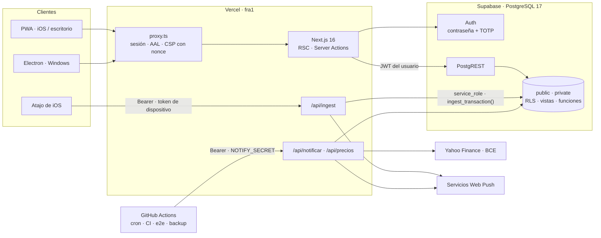
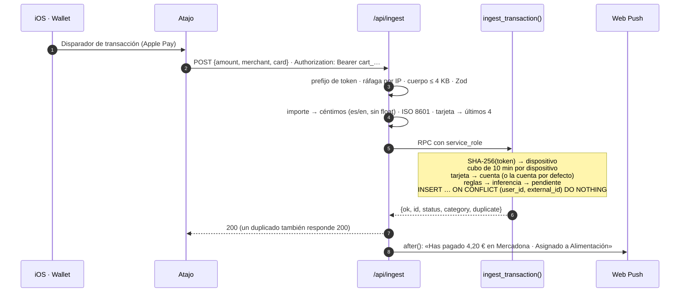

<p align="center">
  <a href="README.md"></a>
  <a href="README.es.md"></a>
</p>

<div align="center">

<picture>
  <source media="(prefers-color-scheme: dark)" srcset="docs/readme/cabecera-oscuro.svg">
  
</picture>

<br>

Aplicación web de finanzas personales, multiusuario y con aislamiento estricto entre cuentas, construida sobre **Next.js 16** (App Router, React Server Components) y **PostgreSQL 17** en Supabase. El dominio vive en la base de datos: los saldos y el patrimonio son **vistas derivadas**, el aislamiento se impone con **RLS y claves foráneas compuestas**, y los cargos de Apple Pay entran por un endpoint autenticado por dispositivo que delega en una **función transaccional de Postgres**.

<br>


</div>

<picture>
  <source media="(prefers-color-scheme: dark)" srcset="docs/readme/separador-oscuro.svg">
  
</picture>

## Presentación

<!--
  CÓMO PONER EL VÍDEO CUANDO ESTÉ LISTO
  1. En GitHub, abre este README con el lápiz (Edit).
  2. Arrastra el .mp4 (hasta 100 MB) a este punto del texto: GitHub lo sube y
     escribe una línea https://github.com/user-attachments/assets/…
  3. Deja esa línea sola, sin nada alrededor: GitHub la convierte en un
     reproductor. Borra entonces el <picture> del póster de aquí debajo.
     Haz lo mismo en README.md, la versión en inglés.
-->

<div align="center">
<picture>
  <source media="(prefers-color-scheme: dark)" srcset="docs/readme/video-oscuro.svg">
  
</picture>
</div>

## Contenido

> 📘 **[Guía de uso](docs/guia/README.es.md)**: qué hace cada pantalla, con capturas, y el Atajo del iPhone paso a paso.

- [Capacidades](#capacidades)
- [Arquitectura](#arquitectura)
- [Modelo de datos](#modelo-de-datos)
- [Modelo de seguridad](#modelo-de-seguridad)
- [Ingesta de pagos de Apple Pay](#ingesta-de-pagos-de-apple-pay)
- [Frontend](#frontend)
- [Calidad y pruebas](#calidad-y-pruebas)
- [Puesta en marcha](#puesta-en-marcha)

## Capacidades

| Módulo | Implementación |
|---|---|
| **Ingesta automática** | Un Atajo de iOS dispara un `POST` por cada cargo de Apple Pay. `ingest_transaction()` autentica el dispositivo, limita la tasa, garantiza la idempotencia, enruta tarjeta → cuenta y clasifica, todo en una única transacción. |
| **Clasificación** | Reglas por patrón de comercio (`merchant_rule`, `private.match_rule`) con aplicación retroactiva. Si ninguna regla acierta, se infiere la categoría a partir del historial (`private.infer_category`), pero solo cuando todo el historial de ese comercio es unánime. |
| **Contabilidad** | Gastos, ingresos y traspasos. Los traspasos no tienen signo y no computan como gasto ni como ingreso. Los reembolsos se imputan a la categoría del gasto enlazado y lo netean. Todo ello lo resuelve una única vista, `v_transaction_econ`. |
| **Presupuestos y alertas** | `budget_status()` calcula el consumo con netting de reembolsos y arrastre opcional del remanente. Avisos al 80 % y al 100 %, y un aviso predictivo por proyección del ritmo de gasto. Las tres alertas se reclaman de forma idempotente (`INSERT … ON CONFLICT DO NOTHING RETURNING`). |
| **Previsión** | Cierre estimado del mes en SQL a partir del ritmo diario, los cargos recurrentes pendientes y las cuotas de préstamo por vencer. |
| **Patrimonio** | Saldo por cuenta y patrimonio neto día a día, derivados de los movimientos (`v_account_balance`, `v_net_worth`, `v_account_worth`). |
| **Inversiones** | Posiciones por participaciones (`position_unit_event`) sobre instrumentos compartidos. Cotizaciones de Yahoo Finance y tipos de cambio del BCE sincronizados a diario. Valoración a mercado y rentabilidad sobre lo aportado. |
| **Préstamos** | Cuadro de amortización francés. Las cuotas se generan solas en su fecha, también la del día 1, aunque caiga en la ventana de silencio de los avisos. |
| **Recurrentes y metas** | Suscripciones e ingresos periódicos con generación por fecha ancla. Metas de ahorro con proyección. |
| **Análisis** | Calendario y mapa de calor del gasto, cascada mensual, ranking de comercios, tendencias por categoría, comparación interanual y cierre de mes. |
| **Notificaciones** | Web Push con VAPID ([RFC 8292](https://www.rfc-editor.org/rfc/rfc8292)): confirmación del cargo en el momento del pago, alertas de presupuesto y recordatorio de pendientes, con ventana de silencio de 23:00 a 08:00 (Europe/Madrid). |
| **E/S de datos** | Importación de extractos CSV con detección de duplicados. Exportación completa a CSV/JSON con paginación por rangos (PostgREST corta a 1.000 filas sin avisar). Informe mensual en Markdown pensado para analizarlo con un LLM. |
| **Clientes** | PWA instalable con service worker versionado por despliegue, y [cliente de escritorio para Windows](escritorio/README.md) (Electron) que envuelve la web publicada. |

<picture>
  <source media="(prefers-color-scheme: dark)" srcset="docs/readme/separador-oscuro.svg">
  
</picture>

## Arquitectura



- **Renderizado.** Server Components por defecto. Las mutaciones van por Server Actions con validación Zod y `revalidatePath`. Los componentes de cliente se reservan para la interacción (formularios, gráficos, hojas). Los datos vienen siempre del servidor, que es la única fuente de verdad: el cliente no guarda copia de ningún dato financiero.
- **Acceso a datos.** Cada petición del usuario consulta PostgREST con **su propio JWT**, así que la RLS se aplica siempre. La clave `service_role` solo aparece en los módulos de servidor que la necesitan: la ingesta, los dos crons, la escritura de datos de mercado compartidos y la generación de invitaciones. Además está vetada en el paquete del cliente por tres comprobaciones de CI.
- **Proxy** ([`src/proxy.ts`](src/proxy.ts)):
  - Refresca la sesión y encamina según el nivel de garantía (AAL).
  - Emite una CSP con nonce por petición.
  - Valida la sesión con `getUser()` contra el servidor de Auth en navegaciones y acciones. En las precargas usa `getClaims()`, que verifica la firma ES256 en local con el JWKS en caché y se ahorra un viaje a Auth por enlace precargado.
- **Trabajos en segundo plano.** GitHub Actions invoca los endpoints de cron con un secreto Bearer, comparado en tiempo constante (`timingSafeEqual`). El trabajo posterior a la respuesta, como el push tras una ingesta, se programa con `after()` para que la plataforma no congele la invocación antes de terminarlo.
- **Zona horaria.** Toda la aritmética de calendario se ancla a `Europe/Madrid` en SQL (`private.hoy()`) y en TypeScript, con un único reloj compartido. Así un cargo de las 00:30 cae en el mes que le toca.

## Modelo de datos

| | |
|---|---|
| Tablas (todas con RLS forzada) | **23** |
| Vistas (`security_invoker`) | **18** |
| Funciones en `public` y `private` | **96** (11 `SECURITY DEFINER`) |
| Políticas RLS | **66** |
| Restricciones `CHECK` | **97** |
| Claves foráneas (compuestas con `user_id`) | **47** |
| Migraciones (solo hacia delante) | **67** |

**Principios del esquema:**

- **Importes en céntimos enteros (`bigint`)** en todas las capas, con un tope de 10¹¹ céntimos. La conversión desde texto (`parseAmountToCents`) acepta el formato español y el anglosajón sin pasar nunca por coma flotante. El motivo: `parseFloat("12,40")` devuelve `12`, y `0.29 * 100` da `28.999999999999996`.
- **Ningún saldo almacenado.** Saldos, patrimonio y rentabilidades se derivan de los movimientos en vistas. Un saldo guardado es un saldo que puede divergir sin que nadie se entere.
- **Semántica contable en un solo sitio.** `v_transaction_econ` excluye los traspasos y netea los reembolsos. Ninguna consulta vuelve a filtrarlos por su cuenta.
- **Idempotencia por diseño:**
  - Altas manuales con un `client_id` único por formulario.
  - Ingesta con `external_id` único por usuario.
  - Importación serializada con un cerrojo por usuario.
  - Generación de cuotas y alertas con reclamación atómica.

<details>
<summary><b>Tablas y vistas</b></summary>

**Tablas.** `account` · `card` · `category` · `transaction` · `merchant_rule` · `budget` · `budget_alert` · `budget_forecast_alert` · `subscription` · `recurring_income` · `savings_goal` · `loan` · `investment_position` · `position_unit_event` · `valuation` · `instrument` · `instrument_price` · `fx_rate` · `ingest_device` · `ingest_bucket` · `ingest_dead_letter` · `push_subscription` · `profile`

**Vistas.** `v_transaction_econ` · `v_account_balance` · `v_account_movement` · `v_account_worth` · `v_net_worth` · `v_month_summary` · `v_closed_months` · `v_subscription_summary` · `v_recurring_income_summary` · `v_savings_goal_progress` · `v_loan_status` · `v_position_value` · `v_position_market` · `v_position_latest` · `v_position_contributions` · `v_pending_valuation` · `v_rule_suggestions` · `v_ingest_health`

</details>

## Modelo de seguridad

El aislamiento entre usuarios descansa en la **base de datos**, no en la interfaz ni en el servidor de aplicación. Un fallo en una Server Action, o una consulta mal escrita, no basta para ver datos de otro.

**Aislamiento**

- **RLS forzada (`FORCE ROW LEVEL SECURITY`) en las 23 tablas.** Todas las políticas se apoyan en `private.current_user_id()`, que devuelve `NULL`, y por tanto ninguna fila, si la sesión no cumple el segundo factor.
- **Segundo factor impuesto en Postgres.** `private.segundo_factor_cumplido()` exige `aal2` en el JWT cuando el usuario tiene un factor TOTP verificado. El encaminamiento del proxy es comodidad, no la barrera.
- **Claves foráneas compuestas `(user_id, id)`.** La comprobación de integridad referencial se ejecuta con privilegios del sistema y **no pasa por la RLS**. Sin la clave compuesta, un usuario podría insertar una fila propia que apuntase a una categoría o cuenta ajena.
- **Vistas con `security_invoker = true`.** Sin ello se ejecutarían con los permisos de su propietario y saltarían la RLS.
- **Funciones `SECURITY DEFINER` con `search_path = ''`** y nombres cualificados por esquema, con `EXECUTE` revocado a `anon` y `authenticated` salvo donde se concede de forma explícita.

**Autenticación y acceso**

- **Registro público deshabilitado.** Las cuentas solo se crean por invitación. Un administrador genera un `token_hash` con `generateLink` y lo comparte como enlace propio, `/invitacion?token_hash=…`. El token **no se canjea en el `GET`**: lo canjea `verifyOtp` cuando el usuario pulsa «Empezar». Así las vistas previas de WhatsApp y los escáneres de correo, que abren el enlace antes que la persona, no lo gastan.
- **No se acepta el flujo implícito** (`#access_token`). Un usuario podría fabricar ese fragmento con su propia sesión y provocar un *login CSRF* en otra.
- **Segundo factor TOTP opcional.** Si está activo, se exige en la base de datos.

**Navegador y transporte**

- **CSP por petición** con `script-src 'nonce-…' 'strict-dynamic'`, sin `unsafe-inline` para scripts, `frame-ancestors 'none'`, `object-src 'none'` y `form-action 'self'`.
- **Cabeceras estáticas:** HSTS con `preload`, `X-Frame-Options: DENY`, `nosniff`, `Referrer-Policy` y `Permissions-Policy`.
- **El `matcher` del proxy está anclado y cubierto por pruebas unitarias.** Ninguna ruta dinámica puede saltarse la CSP ni el encaminamiento de acceso por terminar como un fichero estático.

**Endpoint de ingesta.** Es un endpoint público, así que está diseñado para un token robado:

- El token solo concede **escritura**: no permite leer ni un dato.
- Se guarda como hash SHA-256 en `bytea`, con un máximo de 5 dispositivos por usuario y revocación individual.
- Límite de 60 intentos cada 10 minutos por dispositivo, contando también los rechazos, y una marca única de *rate limited* por ventana.
- Corte de ráfagas por IP en memoria antes de tocar la base, y cuerpo limitado a 4 KB contados en bytes durante la lectura del stream.

**Secretos y cadena de suministro**

- La CI rechaza el build en tres casos: si `.next/static` contiene una clave `sb_secret_`, si contiene un JWT cuyo claim `role` decodificado sea `service_role`, o si un módulo `"use client"` llega a nombrar la variable de la clave.
- Las acciones de GitHub están fijadas por SHA y los *workflows* tienen permisos mínimos.
- `npm audit --omit=dev` está limpio.

**Copias de seguridad.** Volcado semanal de `public` y `private` con `pg_dump`, cifrado con GPG AES-256. Antes de subirlo, el propio *workflow* lo descifra y comprueba que el esquema está entero. Retención de 90 días.

## Ingesta de pagos de Apple Pay



- **Idempotencia frente a los reintentos de iOS.** El disparador de Wallet agota su tiempo de espera y reintenta. Si el Atajo no envía un `external_id`, la ruta reutiliza el del cargo idéntico que ese mismo dispositivo haya registrado en los últimos 90 s. Si no lo hay, genera uno nuevo. Así un reintento no duplica el cargo, y dos cargos iguales legítimos no se funden en uno.
- **Ningún pago se pierde.** Todo rechazo (importe, fecha, tarjeta, error de la base) queda en `ingest_dead_letter` con su motivo y su payload, visible desde Ajustes. Un error transitorio responde `500` para que el Atajo reintente. Un error de datos (SQLSTATE 22/23) responde `422`.
- **Diagnóstico desde el móvil.** Cada rechazo devuelve lo que llegó (`recibido`) y una pista accionable. Por ejemplo, detecta que se ha enviado el nombre literal de la variable en lugar de su valor.

## Frontend

- **Sistema de diseño «Aurora».** Todos los colores, radios, sombras y materiales son tokens CSS en [`globals.css`](src/app/globals.css), expuestos a Tailwind 4 con `@theme`. El tema oscuro es el principal y el claro es secundario. Hay un único acento iridiscente (violeta → cian → oro) y un solo punto de ruptura (`lg`, 1024 px). El orden del DOM es siempre el de móvil.
- **Gráficos propios en SVG**, sin librerías de gráficas: `linea-interactiva`, `barras-interactivas`, `barras-ranking`, `donut-aurora` y `banda-aurora`. La aritmética está aislada en `src/lib/graficos.ts` y probada. Una sola mecánica de lectura por puntero, que se procesa una vez por fotograma.
- **Accesibilidad.** Auditoría con axe en la suite e2e, `prefers-reduced-motion` respetado en toda la app y ningún texto por debajo de 13 px.
- **PWA.** El service worker se sirve desde una ruta que le inyecta la versión del despliegue, de modo que cada despliegue invalida la caché anterior y la app ofrece actualizar. Solo se cachean recursos estáticos con hash y la página sin conexión. Nunca HTML con datos, ni `/api/`, ni respuestas de otro origen.

<picture>
  <source media="(prefers-color-scheme: dark)" srcset="docs/readme/banda-oscuro.svg">
  
</picture>

## Calidad y pruebas

| Capa | Herramienta | Alcance |
|---|---|---|
| Unitarias | Vitest · fast-check | **789 pruebas** en 51 ficheros. Dinero, fechas y parser CSV con pruebas de propiedades, Server Actions y rutas con dependencias simuladas, y el `matcher` del proxy. |
| Base de datos | `pg` contra PostgreSQL real | **40 suites** que se ejecutan dentro de una transacción con `ROLLBACK`. Aislamiento entre usuarios, invariantes financieros, ingesta, alertas y concurrencia. Con `--pendientes`, aplican antes las migraciones aún no desplegadas, de modo que se prueba el esquema posterior a `db push` sin tocar producción. |
| Auditoría de esquema | `npm run db:audit` | RLS forzada en toda tabla, `security_invoker` en toda vista, `search_path` fijado en toda función `DEFINER`, ausencia de columnas de saldo y claves foráneas compuestas. |
| Extremo a extremo | Playwright · axe-core | **21 especificaciones**: altas, traspasos, reembolsos, préstamos, inversiones, accesibilidad completa, desbordes a 320 px y comportamiento sin red. |
| Despliegue | `scripts/check-deploy.mjs` | Comprobación del entorno publicado: rutas, ingesta, service worker, manifiesto y ausencia de credenciales en el HTML y en los *chunks* diferidos. |

**Integración continua.** En cada `push` se ejecutan lint, `tsc --noEmit`, las pruebas unitarias, `next build` y los tres escáneres de secretos sobre el paquete del cliente. La suite e2e corre en un *workflow* aparte, con un usuario de CI dedicado.

## Puesta en marcha

**Requisitos:** Node.js 24, un proyecto de Supabase y la CLI de Supabase (incluida como dependencia de desarrollo).

```bash
npm install
cp .env.example .env.local          # rellenar las variables de abajo
npm run db:push                     # aplica supabase/migrations
npm run dev                         # http://localhost:3000
```

| Variable | Ámbito | Uso |
|---|---|---|
| `NEXT_PUBLIC_SUPABASE_URL` · `NEXT_PUBLIC_SUPABASE_ANON_KEY` | Cliente y servidor | Conexión a Supabase. La RLS hace segura la clave anónima. |
| `SUPABASE_SERVICE_ROLE_KEY` | Solo servidor | Ingesta, crons y datos de mercado compartidos. Nunca con el prefijo `NEXT_PUBLIC_`. |
| `NEXT_PUBLIC_VAPID_PUBLIC_KEY` · `VAPID_PRIVATE_KEY` · `VAPID_SUBJECT` | Servidor (la pública también en el cliente) | Web Push. |
| `NOTIFY_SECRET` | Servidor y GitHub Actions | Autenticación de `/api/notificar` y `/api/precios`. |
| `CARTERA_ADMIN_IDS` · `CARTERA_ENLACE_CADUCA_HORAS` | Servidor | Quién puede invitar y la caducidad que se comunica en el enlace. |
| `DATABASE_URL` | Scripts locales | Migraciones, auditoría y pruebas de base de datos (pooler en modo sesión). |

| Comando | Descripción |
|---|---|
| `npm run lint` · `typecheck` · `test` · `build` | Las cuatro comprobaciones obligatorias antes de integrar un cambio |
| `npm run e2e` | Suite de Playwright |
| `npm run db:push` | Aplica las migraciones pendientes (solo hacia delante: una migración aplicada no se edita) |
| `npm run db:audit` | Auditoría de invariantes del esquema |
| `npm run db:test` | Pruebas de aislamiento entre usuarios contra la base real |
| `npm run readme:banners` | Regenera los banners SVG de este README |
| `scripts/seed-guia.mjs` · `scripts/capturas-guia.mjs` | Datos de demostración y capturas de la [guía de uso](docs/guia/README.es.md) (solo usuarios `@cartera.local`) |

<details>
<summary><b>Estructura del repositorio</b></summary>

```
src/
  app/                App Router: (app) autenticada, (auth) acceso, api/ (ingesta, crons,
                      exportación, informe), sw.js versionado, tokens de diseño
  components/         UI por dominio y primitivos de gráficos (components/ui)
  lib/                Dominio puro y probado: dinero, fechas, CSV, préstamos, ingesta,
                      acceso, invitaciones, paginación de PostgREST
  proxy.ts            Sesión, AAL y CSP con nonce
supabase/migrations/  Esquema, RLS, vistas de cálculo y funciones (solo hacia delante)
scripts/              Auditoría y pruebas de base de datos, comprobación de despliegue
e2e/                  Playwright
docs/guia/            Guía de uso con capturas y el Atajo del iPhone paso a paso
escritorio/           Cliente de Windows (Electron) sobre la web publicada
.github/workflows/    CI, e2e, crons de avisos y precios, copia cifrada, instalador
```

</details>

Las convenciones del proyecto, los invariantes y el sistema de diseño están documentados en [`AGENTS.md`](AGENTS.md). El uso de la aplicación, pantalla a pantalla, en la [guía de uso](docs/guia/README.es.md).

## Licencia

© 2026 Pablo Martinez Conde. **Todos los derechos reservados.** El código se publica para consultarlo como portafolio; no se concede licencia para copiarlo, modificarlo, desplegarlo ni reutilizarlo. Detalles en [`LICENSE`](LICENSE).

<picture>
  <source media="(prefers-color-scheme: dark)" srcset="docs/readme/pie-oscuro.svg">
  
</picture>

<sub>Banners generados por [`scripts/readme-banners.mjs`](scripts/readme-banners.mjs): SVG con animación CSS y el texto convertido en trazos con [Space Grotesk](https://github.com/floriankarsten/space-grotesk) (SIL Open Font License 1.1, ver [`docs/readme/fuente/OFL.txt`](docs/readme/fuente/OFL.txt)).</sub>
