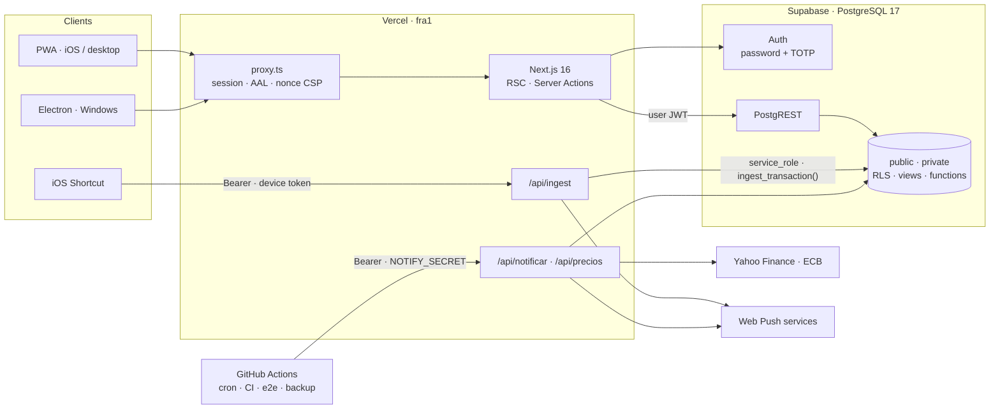
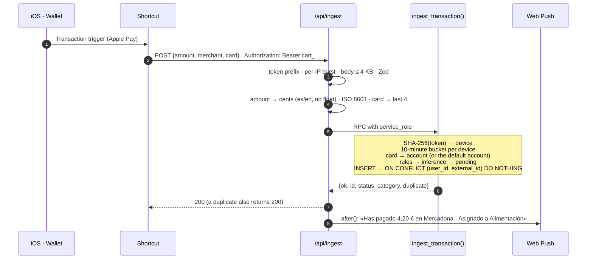

<p align="center">
  <a href="README.md"></a>
  <a href="README.es.md"></a>
</p>

<div align="center">

<picture>
  <source media="(prefers-color-scheme: dark)" srcset="docs/readme/cabecera-en-oscuro.svg">
  
</picture>

<br>

A multi-user personal finance web app with strict per-account isolation, built on **Next.js 16** (App Router, React Server Components) and **PostgreSQL 17** on Supabase. The domain lives in the database: balances and net worth are **derived views**, isolation is enforced with **RLS and composite foreign keys**, and Apple Pay charges come in through a device-authenticated endpoint that delegates to a **transactional Postgres function**.

<br>


</div>

<picture>
  <source media="(prefers-color-scheme: dark)" srcset="docs/readme/separador-oscuro.svg">
  
</picture>

## Walkthrough

<!--
  HOW TO ADD THE VIDEO WHEN IT IS READY
  1. On GitHub, open this README with the pencil icon (Edit).
  2. Drag the .mp4 (up to 100 MB) to this spot: GitHub uploads it and writes a
     https://github.com/user-attachments/assets/… line.
  3. Leave that line on its own: GitHub turns it into a player. Then delete
     the poster <picture> below. Do the same in README.es.md.
-->

<div align="center">
<picture>
  <source media="(prefers-color-scheme: dark)" srcset="docs/readme/video-en-oscuro.svg">
  
</picture>
</div>

## Contents

> 📘 **[User guide](docs/guia/README.md)**: what every screen does, with screenshots, and the iPhone Shortcut set up step by step.

- [Capabilities](#capabilities)
- [Architecture](#architecture)
- [Data model](#data-model)
- [Security model](#security-model)
- [Apple Pay ingestion](#apple-pay-ingestion)
- [Frontend](#frontend)
- [Quality and testing](#quality-and-testing)
- [Getting started](#getting-started)

> [!NOTE]
> The app, its code and its comments are in Spanish: it was built for Spanish-speaking users, and identifiers such as `segundo_factor_cumplido` or `hoyMadrid` are kept as they are in the source.

## Capabilities

| Module | Implementation |
|---|---|
| **Automatic ingestion** | An iOS Shortcut fires a `POST` for every Apple Pay charge. `ingest_transaction()` authenticates the device, rate-limits, guarantees idempotency, routes card → account and categorises, all in a single transaction. |
| **Categorisation** | Merchant-pattern rules (`merchant_rule`, `private.match_rule`) that can be applied retroactively. When no rule matches, the category is inferred from history (`private.infer_category`), but only when that merchant's entire history agrees. |
| **Accounting** | Expenses, income and transfers. Transfers carry no sign and never count as spending or income. Refunds are attributed to the linked expense's category and net it down. A single view, `v_transaction_econ`, resolves all of this. |
| **Budgets and alerts** | `budget_status()` computes consumption with refund netting and optional rollover. Alerts at 80 % and 100 %, plus a predictive alert projected from the spending pace. All three are claimed idempotently (`INSERT … ON CONFLICT DO NOTHING RETURNING`). |
| **Forecast** | Estimated month-end close in SQL from the daily pace, pending recurring charges and upcoming loan instalments. |
| **Net worth** | Per-account balance and daily net worth, derived from transactions (`v_account_balance`, `v_net_worth`, `v_account_worth`). |
| **Investments** | Unit-based positions (`position_unit_event`) over shared instruments. Yahoo Finance prices and ECB exchange rates synced daily. Mark-to-market valuation and return on contributed capital. |
| **Loans** | French amortisation schedule. Instalments are generated on their due date, including the one on the 1st even when it falls inside the notifications' quiet hours. |
| **Recurring items and goals** | Subscriptions and periodic income generated from an anchor date. Savings goals with projections. |
| **Analytics** | Spending calendar and heat map, monthly waterfall, merchant ranking, per-category trends, year-over-year comparison and month-end close. |
| **Notifications** | Web Push with VAPID ([RFC 8292](https://www.rfc-editor.org/rfc/rfc8292)): charge confirmation at the moment of payment, budget alerts and a reminder for pending items, with quiet hours from 23:00 to 08:00 (Europe/Madrid). |
| **Data I/O** | CSV bank-statement import with duplicate detection. Full CSV/JSON export with range pagination (PostgREST silently caps responses at 1,000 rows). Monthly report in Markdown, designed to be analysed with an LLM. |
| **Clients** | Installable PWA with a service worker versioned per deployment, and a [Windows desktop client](escritorio/README.md) (Electron) that wraps the deployed web app. |

<picture>
  <source media="(prefers-color-scheme: dark)" srcset="docs/readme/separador-oscuro.svg">
  
</picture>

## Architecture



- **Rendering.** Server Components by default. Mutations go through Server Actions with Zod validation and `revalidatePath`. Client components are reserved for interaction (forms, charts, sheets). Data always comes from the server, the single source of truth: the client keeps no copy of any financial data.
- **Data access.** Every user request hits PostgREST with **the user's own JWT**, so RLS always applies. The `service_role` key only appears in the server modules that need it: ingestion, the two cron endpoints, writing shared market data and generating invitations. Three CI checks also keep it out of the client bundle.
- **Proxy** ([`src/proxy.ts`](src/proxy.ts)):
  - Refreshes the session and routes by authenticator assurance level (AAL).
  - Emits a per-request nonce CSP.
  - Validates the session with `getUser()` against the Auth server on navigations and actions. Prefetches use `getClaims()`, which verifies the ES256 signature locally against the cached JWKS and saves an Auth round trip per prefetched link.
- **Background work.** GitHub Actions calls the cron endpoints with a Bearer secret, compared in constant time (`timingSafeEqual`). Post-response work, such as the push after an ingestion, is scheduled with `after()` so the platform does not freeze the invocation before it finishes.
- **Time zone.** All calendar arithmetic is anchored to `Europe/Madrid` in SQL (`private.hoy()`) and in TypeScript, from a single shared clock. A charge at 00:30 therefore lands in the right month.

## Data model

| | |
|---|---|
| Tables (all with forced RLS) | **23** |
| Views (`security_invoker`) | **18** |
| Functions in `public` and `private` | **96** (11 `SECURITY DEFINER`) |
| RLS policies | **66** |
| `CHECK` constraints | **97** |
| Foreign keys (composite with `user_id`) | **47** |
| Migrations (forward-only) | **67** |

**Schema principles:**

- **Amounts in integer cents (`bigint`)** at every layer, capped at 10¹¹ cents. Text conversion (`parseAmountToCents`) accepts both Spanish and English number formats and never goes through floating point. The reason: `parseFloat("12,40")` returns `12`, and `0.29 * 100` gives `28.999999999999996`.
- **No stored balances.** Balances, net worth and returns are derived from transactions in views. A stored balance is a balance that can drift without anyone noticing.
- **Accounting semantics in one place.** `v_transaction_econ` excludes transfers and nets refunds. No query filters them again on its own.
- **Idempotency by design:**
  - Manual entries carry a `client_id` unique per form.
  - Ingestion uses an `external_id` unique per user.
  - Imports are serialised with a per-user lock.
  - Instalment and alert generation use atomic claims.

<details>
<summary><b>Tables and views</b></summary>

**Tables.** `account` · `card` · `category` · `transaction` · `merchant_rule` · `budget` · `budget_alert` · `budget_forecast_alert` · `subscription` · `recurring_income` · `savings_goal` · `loan` · `investment_position` · `position_unit_event` · `valuation` · `instrument` · `instrument_price` · `fx_rate` · `ingest_device` · `ingest_bucket` · `ingest_dead_letter` · `push_subscription` · `profile`

**Views.** `v_transaction_econ` · `v_account_balance` · `v_account_movement` · `v_account_worth` · `v_net_worth` · `v_month_summary` · `v_closed_months` · `v_subscription_summary` · `v_recurring_income_summary` · `v_savings_goal_progress` · `v_loan_status` · `v_position_value` · `v_position_market` · `v_position_latest` · `v_position_contributions` · `v_pending_valuation` · `v_rule_suggestions` · `v_ingest_health`

</details>

## Security model

Isolation between users rests on the **database**, not on the UI or the application server. A bug in a Server Action, or a badly written query, is not enough to see someone else's data.

**Isolation**

- **Forced RLS (`FORCE ROW LEVEL SECURITY`) on all 23 tables.** Every policy relies on `private.current_user_id()`, which returns `NULL`, and therefore no rows, if the session does not meet the second-factor requirement.
- **Second factor enforced in Postgres.** `private.segundo_factor_cumplido()` requires `aal2` in the JWT whenever the user has a verified TOTP factor. Routing in the proxy is a convenience, not the barrier.
- **Composite foreign keys `(user_id, id)`.** Referential integrity checks run with system privileges and **bypass RLS**. Without the composite key, a user could insert a row of their own pointing at someone else's category or account.
- **Views with `security_invoker = true`.** Otherwise they would run with their owner's privileges and skip RLS.
- **`SECURITY DEFINER` functions with `search_path = ''`** and schema-qualified names, with `EXECUTE` revoked from `anon` and `authenticated` except where explicitly granted.

**Authentication and access**

- **Public sign-up disabled.** Accounts are only created by invitation. An admin generates a `token_hash` with `generateLink` and shares it as an app link, `/invitacion?token_hash=…`. The token is **not redeemed on `GET`**: `verifyOtp` redeems it when the user taps «Empezar» (Start). That way WhatsApp previews and mail scanners, which open the link before the person does, cannot burn it.
- **The implicit flow is rejected** (`#access_token`). A user could forge that fragment with their own session and cause a *login CSRF* on someone else.
- **Optional TOTP second factor.** When enabled, the database enforces it.

**Browser and transport**

- **Per-request CSP** with `script-src 'nonce-…' 'strict-dynamic'`, no `unsafe-inline` for scripts, `frame-ancestors 'none'`, `object-src 'none'` and `form-action 'self'`.
- **Static headers:** HSTS with `preload`, `X-Frame-Options: DENY`, `nosniff`, `Referrer-Policy` and `Permissions-Policy`.
- **The proxy `matcher` is anchored and covered by unit tests.** No dynamic route can skip the CSP or the access routing by looking like a static file.

**Ingestion endpoint.** It is a public endpoint, so it is designed around a stolen token:

- The token only grants **write** access: it cannot read a single figure.
- It is stored as a SHA-256 hash in `bytea`, with at most 5 devices per user and individual revocation.
- 60 attempts per 10 minutes per device, rejections included, with a single *rate limited* marker per window.
- An in-memory per-IP burst guard before touching the database, and a 4 KB body cap counted in bytes while reading the stream.

**Secrets and supply chain**

- CI fails the build in three cases: if `.next/static` contains an `sb_secret_` key, if it contains a JWT whose decoded `role` claim is `service_role`, or if a `"use client"` module so much as names the key's variable.
- GitHub Actions are pinned by SHA and workflows run with minimal permissions.
- `npm audit --omit=dev` is clean.

**Backups.** Weekly `pg_dump` of `public` and `private`, encrypted with GPG AES-256. Before uploading, the workflow itself decrypts it and checks the schema is complete. 90-day retention.

## Apple Pay ingestion



- **Idempotency against iOS retries.** The Wallet trigger times out and retries. If the Shortcut sends no `external_id`, the route reuses the one from an identical charge registered by the same device in the last 90 s. If there is none, it generates a new one. A retry never duplicates a charge, and two legitimate identical charges are never merged into one.
- **No payment is ever lost.** Every rejection (amount, date, card, database error) is kept in `ingest_dead_letter` with its reason and payload, visible from Settings. A transient error returns `500` so the Shortcut retries. A data error (SQLSTATE 22/23) returns `422`.
- **Diagnosable from the phone.** Every rejection returns what was received (`recibido`) and an actionable hint. For instance, it detects when the literal variable name was sent instead of its value.

## Frontend

- **«Aurora» design system.** Every colour, radius, shadow and material is a CSS token in [`globals.css`](src/app/globals.css), exposed to Tailwind 4 through `@theme`. Dark is the primary theme and light is secondary. There is a single iridescent accent (violet → cyan → gold) and a single breakpoint (`lg`, 1024 px). DOM order always follows the mobile layout.
- **Hand-built SVG charts**, no charting library: `linea-interactiva`, `barras-interactivas`, `barras-ranking`, `donut-aurora` and `banda-aurora`. The arithmetic is isolated in `src/lib/graficos.ts` and tested. One shared pointer-reading mechanism, processed once per frame.
- **Accessibility.** axe audits in the e2e suite, `prefers-reduced-motion` honoured across the app, and no text below 13 px.
- **PWA.** The service worker is served from a route that injects the deployment version, so every deployment invalidates the previous cache and the app offers to update. Only hashed static assets and the offline page are cached. Never HTML with data, `/api/` or cross-origin responses.

<picture>
  <source media="(prefers-color-scheme: dark)" srcset="docs/readme/banda-en-oscuro.svg">
  
</picture>

## Quality and testing

| Layer | Tooling | Scope |
|---|---|---|
| Unit | Vitest · fast-check | **789 tests** across 51 files. Money, dates and the CSV parser with property-based tests, Server Actions and routes with mocked dependencies, and the proxy `matcher`. |
| Database | `pg` against a real PostgreSQL | **40 suites** that run inside a transaction ending in `ROLLBACK`. Isolation between users, financial invariants, ingestion, alerts and concurrency. With `--pendientes`, they first apply not-yet-deployed migrations, so the post-`db push` schema is tested without touching production. |
| Schema audit | `npm run db:audit` | Forced RLS on every table, `security_invoker` on every view, a fixed `search_path` on every `DEFINER` function, no balance columns, and composite foreign keys. |
| End-to-end | Playwright · axe-core | **21 specs**: entries, transfers, refunds, loans, investments, full accessibility, overflow at 320 px and offline behaviour. |
| Deployment | `scripts/check-deploy.mjs` | Checks on the deployed environment: routes, ingestion, service worker, manifest, and no credentials in the HTML or in lazily loaded chunks. |

**Continuous integration.** Every `push` runs lint, `tsc --noEmit`, the unit tests, `next build` and the three secret scanners over the client bundle. The e2e suite runs in a separate workflow with a dedicated CI user.

## Getting started

**Requirements:** Node.js 24, a Supabase project and the Supabase CLI (included as a dev dependency).

```bash
npm install
cp .env.example .env.local          # fill in the variables below
npm run db:push                     # applies supabase/migrations
npm run dev                         # http://localhost:3000
```

| Variable | Scope | Purpose |
|---|---|---|
| `NEXT_PUBLIC_SUPABASE_URL` · `NEXT_PUBLIC_SUPABASE_ANON_KEY` | Client and server | Supabase connection. RLS is what makes the anonymous key safe. |
| `SUPABASE_SERVICE_ROLE_KEY` | Server only | Ingestion, cron jobs and shared market data. Never with a `NEXT_PUBLIC_` prefix. |
| `NEXT_PUBLIC_VAPID_PUBLIC_KEY` · `VAPID_PRIVATE_KEY` · `VAPID_SUBJECT` | Server (the public key also on the client) | Web Push. |
| `NOTIFY_SECRET` | Server and GitHub Actions | Authenticates `/api/notificar` and `/api/precios`. |
| `CARTERA_ADMIN_IDS` · `CARTERA_ENLACE_CADUCA_HORAS` | Server | Who can invite, and the expiry shown with the link. |
| `DATABASE_URL` | Local scripts | Migrations, audit and database tests (session-mode pooler). |

| Command | Description |
|---|---|
| `npm run lint` · `typecheck` · `test` · `build` | The four mandatory checks before merging a change |
| `npm run e2e` | Playwright suite |
| `npm run db:push` | Applies pending migrations (forward-only: an applied migration is never edited) |
| `npm run db:audit` | Schema invariant audit |
| `npm run db:test` | User-isolation tests against the real database |
| `npm run readme:banners` | Regenerates this README's SVG banners |
| `scripts/seed-guia.mjs` · `scripts/capturas-guia.mjs` | Demo data and screenshots for the [user guide](docs/guia/README.md) (`@cartera.local` users only) |

<details>
<summary><b>Repository layout</b></summary>

```
src/
  app/                App Router: (app) authenticated, (auth) sign-in, api/ (ingestion, cron,
                      export, report), versioned sw.js, design tokens
  components/         UI by domain and chart primitives (components/ui)
  lib/                Pure, tested domain code: money, dates, CSV, loans, ingestion,
                      access, invitations, PostgREST pagination
  proxy.ts            Session, AAL and nonce CSP
supabase/migrations/  Schema, RLS, calculation views and functions (forward-only)
scripts/              Database audit and tests, deployment checks
e2e/                  Playwright
docs/guia/            User guide with screenshots and the iPhone Shortcut step by step
escritorio/           Windows client (Electron) over the deployed web app
.github/workflows/    CI, e2e, notification and price cron jobs, encrypted backup, installer
```

</details>

Project conventions, invariants and the design system are documented (in Spanish) in [`AGENTS.md`](AGENTS.md). Day-to-day use of the app, screen by screen, is in the [user guide](docs/guia/README.md).

## License

© 2026 Pablo Martinez Conde. **All rights reserved.** The code is published for viewing as a portfolio piece; no license is granted to copy, modify, deploy or reuse it. See [`LICENSE`](LICENSE).

<picture>
  <source media="(prefers-color-scheme: dark)" srcset="docs/readme/pie-oscuro.svg">
  
</picture>

<sub>Banners generated by [`scripts/readme-banners.mjs`](scripts/readme-banners.mjs): SVG with CSS animation and text converted to outlines in [Space Grotesk](https://github.com/floriankarsten/space-grotesk) (SIL Open Font License 1.1, see [`docs/readme/fuente/OFL.txt`](docs/readme/fuente/OFL.txt)).</sub>
