  
  

<picture>
  <source media="(prefers-color-scheme: dark)" srcset="../readme/cabecera-oscuro.svg">
  
</picture>

# Guía de uso

Qué hace cada pantalla de Cartera y cómo montar el Atajo del iPhone, paso a paso.

Las capturas son de un usuario de demostración (`fase3@cartera.local`) con datos inventados, generados con [`scripts/seed-guia.mjs`](../../scripts/seed-guia.mjs).

---

## Contenido

1. [Primeros pasos](#1-primeros-pasos)
2. [Cómo se mueve uno por la app](#2-cómo-se-mueve-uno-por-la-app)
3. [Resumen](#3-resumen)
4. [Movimientos](#4-movimientos)
5. [Cuentas](#5-cuentas)
6. [Patrimonio](#6-patrimonio)
7. [Análisis](#7-análisis)
8. [Fijos](#8-fijos)
9. [Metas](#9-metas)
10. [Inversiones](#10-inversiones)
11. [Préstamos](#11-préstamos)
12. [Categorías y reglas de comercio](#12-categorías-y-reglas-de-comercio)
13. [Importar del banco](#13-importar-del-banco)
14. [Ajustes](#14-ajustes)
15. [El Atajo del iPhone, paso a paso (iOS 27)](#15-el-atajo-del-iphone-paso-a-paso-ios-27)
16. [Problemas frecuentes](#16-problemas-frecuentes)

---

## 1. Primeros pasos

**Cuenta por invitación.** Cartera no tiene registro abierto. Quien administra la app genera un enlace desde *Ajustes → Invitar* y te lo pasa, normalmente por WhatsApp.

Al abrirlo:
1. Ves una bienvenida y pulsas **Empezar**. Hasta ese momento el enlace no se gasta, así que la vista previa de WhatsApp no lo inutiliza.
2. Eliges tu contraseña, de al menos 12 caracteres.
3. Opcionalmente, activas el **segundo factor**: un código de 6 dígitos que genera tu móvil. Si lo activas, se pide en cada acceso nuevo.

Después entras con **correo y contraseña** y, si lo tienes activo, el código.

  
  

**Instálala como app.**
- **iPhone:** ábrela en **Safari** → *Compartir* → **Añadir a pantalla de inicio**. Se abre a pantalla completa, con su icono, y es la única forma de recibir avisos en iPhone.
- **PC:** en Chrome o Edge, el icono de *Instalar* de la barra de direcciones. En Windows también hay una [app de escritorio](../../escritorio/README.md).

## 2. Cómo se mueve uno por la app

| | Móvil | Escritorio (desde 1024 px) |
|---|---|---|
| Navegación | Barra inferior: Resumen, Movimientos, **+**, Cuentas y Ajustes. El resto de pantallas cuelga de ellas. | Barra lateral con todas las pantallas. |
| Añadir un movimiento | El botón **+** central. | **Añadir movimiento**, arriba en la barra lateral. |
| Buscar | Lupa de Movimientos. | <kbd>Ctrl</kbd> + <kbd>K</kbd> desde cualquier sitio: busca en todo el histórico. |
| Aviso de pendientes | Contador rojo sobre *Movimientos*: pagos del Atajo sin categoría. | Igual, en la barra lateral. |

## 3. Resumen

La pantalla de inicio: **el mes de un vistazo**.

- **Gasto del mes**, comparado con el mes anterior a estas alturas. Debajo, lo pagado y lo que te han devuelto (reembolsos).
- **Por categoría**: la *banda Aurora*. Cada color es una categoría y su anchura, lo que se ha llevado del gasto. Tócala para leer cada tramo.
- **Atención a tus límites**: la previsión de cierre y qué límites vas camino de pasar a este ritmo.
- **Pagos pendientes de confirmar**: lo que llegó del Atajo y ninguna regla supo clasificar. Toca para resolverlo.
- **Ritmo del mes**: el gasto acumulado día a día frente al mismo punto del mes pasado (la línea discontinua).

Las flechas de arriba cambian de mes.

  
  

## 4. Movimientos

  
  
  
  

**La lista.** Todos los movimientos del mes, con buscador y filtros por tipo, categoría, cuenta, origen (*solo automáticos*) y estado (*pendientes*). **Sin clasificar por mes** enseña en qué meses se acumulan pagos sin categoría. Esos son los meses a los que les faltan reglas.

**Añadir.** Hay tres tipos:
- **Gasto** e **Ingreso**: importe, descripción, fecha y hora, cuenta y categoría. El importe se escribe con coma: `12,40`.
- **Traspaso**: mueve dinero entre dos cuentas tuyas. No cuenta como gasto ni como ingreso. Sirve, por ejemplo, para llevar dinero al ahorro.
- **Guardar y añadir otro** conserva la cuenta, para apuntar varios seguidos.

**El detalle** (tocar un movimiento) enseña de dónde vino (a mano, del Atajo con su comercio y tarjeta, de un fijo o de una importación) y permite editarlo o borrarlo. Un pago **pendiente** se resuelve aquí eligiendo su categoría.

**Reembolsos.** Si alguien te devuelve parte de un gasto (el Bizum de la cena), apúntalo como ingreso y **enlázalo al gasto**. No cuenta como ingreso: abarata ese gasto. El detalle lo dice así: *«Te costó de verdad 48,00 €. Pagaste 96,00 € y te devolvieron 48,00 €»*.

## 5. Cuentas

Tus cuentas con su **saldo actual**: bancos, efectivo, ahorro, inversión y la deuda de los préstamos. El total de arriba es lo que tienes menos lo que debes.

- El saldo **no se escribe a mano**: se calcula siempre a partir del saldo inicial y los movimientos, así que nunca se descuadra.
- Cada cuenta puede tener **varias tarjetas** (sus 4 últimos dígitos). Así el Atajo sabe a qué cuenta va cada pago.
- Una cuenta que ya no usas se puede **archivar**: deja de estorbar sin perder su historia. También se puede **eliminar**; antes de hacerlo, Cartera enseña qué se llevaría por delante.

  

## 6. Patrimonio

**Lo que tienes, en conjunto**: dinero en cuentas, más lo que valen tus inversiones, menos lo que debes.

- **Evolución** día a día, con el máximo y el mínimo del periodo marcados en oro. Rangos de 1 mes a todo el histórico.
- **Caja, invertido y deuda**: qué parte de tu patrimonio está invertida.
- **Ahorro mes a mes** y cierre de cada año.

  

## 7. Análisis

Para entender **en qué se va el dinero**:

- **Cierre previsto del mes**, según tu ritmo y lo que falta por cargar (fijos y cuotas).
- **Qué está pasando**: pendientes, gasto sin clasificar, límites pasados y rachas de ahorro.
- **Año a año**: cada mes frente al mismo mes del año anterior.
- **Calendario y mapa de calor**: qué días y a qué horas gastas más.
- **Comercios** donde más gastas, **tendencias** por categoría y **cascada** del mes.

Arriba a la derecha:
- **Informe**: descarga el resumen del mes en Markdown, pensado para pegárselo a un asistente y preguntarle qué ajustar.
- **Cierre de mes**: repaso del mes terminado.

  
  

## 8. Fijos

Lo que **se repite**: suscripciones, recibos y la nómina.

- **Neto fijo al mes**: con cuánto arrancas cada mes. Es lo que entra fijo menos lo que sale fijo, antes del gasto del día a día.
- **Gastos fijos** e **Ingresos fijos**, cada uno con su periodicidad (semanal, mensual, trimestral o anual) y su próxima fecha.
- Se **apuntan solos** el día que toca. No hay que registrarlos a mano cada mes.

  

## 9. Metas

Objetivos de ahorro, cada uno ligado a una cuenta: *Viaje a Japón: 4.500 € en ING Ahorro antes de junio*.

- Progreso, lo que falta y **cuánto apartar al mes** para llegar a tiempo.
- **Proyección**: a tu ritmo actual, cuándo llegarás.

  

## 10. Inversiones

Fondos, ETF y acciones.

- **Sigue un instrumento** buscándolo por nombre, ISIN o símbolo. Su precio se actualiza **solo cada día** (Yahoo Finance) y, si cotiza en otra divisa, se convierte a euros con el cambio del BCE.
- Para cada posición: **aportado, valor, ganancia y rentabilidad**. La rentabilidad se mide sobre lo aportado: meter dinero no cuenta como ganar.
- Avisa si gran parte del dinero está en una sola posición.
- Las posiciones sin cotización se valoran a mano.

  

## 11. Préstamos

Hipotecas, préstamos de coche o personales.

- Se dan de alta con capital, plazo, TIN (y TAE si la sabes), día de cobro y fecha de inicio. Cartera calcula el **cuadro de amortización** (sistema francés).
- Cada mes la **cuota se apunta sola**, separando intereses (gasto) y capital (lo que reduce la deuda).
- **Deuda pendiente**, cuotas pagadas, intereses por pagar y fecha de fin. Un préstamo se puede **liquidar** o cancelar.
- **Aportación extra**: pagas capital de más un mes y eliges **reducir plazo** (la misma cuota y terminas antes, lo que más ahorra) o **reducir cuota** (terminas igual y pagas menos). La vista previa dice antes de guardar cuándo terminas, cuántas cuotas quedan y **cuántos intereses te ahorras**, y el cuadro se recalcula. La última aportación se puede deshacer mientras no se cobre otra cuota.
- **Simulador «quiero terminar en N meses»**: cuánto pagar de más cada mes, o cuánto aportar de una vez hoy, y lo que ahorras. Un toque rellena la aportación.
- **Pagar todo lo que queda** está a un toque en la ficha del préstamo.

  

## 12. Categorías y reglas de comercio

**Categorías**: de gasto, de ingreso y de traspaso, con su color e icono. Las de gasto son las que reparte la banda del Resumen.

**Reglas de comercio**: cuando llega un pago del Atajo, Cartera busca una regla cuyo texto aparezca en el nombre del comercio (`MERCADONA` → *Supermercado*).
- Si acierta, el pago entra **ya clasificado**.
- Si no hay regla pero **siempre** has clasificado ese comercio igual, hereda esa categoría.
- Si no, queda **pendiente**.

Al crear una regla puedes aplicarla de golpe a los pagos anteriores. Cada regla cuenta cuántas veces ha acertado.

  
  

## 13. Importar del banco

Para traer de una vez lo que el Atajo no captura (pagos con tarjeta física, recibos, compras online):

1. Elige la **cuenta de destino** y sube el **CSV** del banco, o pega su contenido.
2. Cartera detecta el separador y propone qué columna es la fecha, el concepto y el importe. Puedes corregirlo, y te **enseña lo que va a entrar antes de escribir nada**.
3. Marca los movimientos que **ya existen**, para no duplicar.

El fichero no se guarda: solo se leen sus filas.

  

## 14. Ajustes

- **Apariencia**: claro, oscuro o automático.
- **El Atajo del iPhone**: conectar un dispositivo (genera el *token*), ver cuántos envíos lleva y revocarlo, y elegir la **cuenta por defecto** para pagos con una tarjeta que Cartera no reconoce.
- **Avisos en el móvil**: activar las notificaciones de este dispositivo.
- **Tus datos**: informe del mes, exportación a CSV o a JSON completo, e importar.
- **Seguridad**: activar o quitar el segundo factor.
- **Invitar** (solo administradores): genera el enlace para que alguien entre.

  
  
  

**Qué avisos llegan.** En iPhone solo llegan con la app instalada en la pantalla de inicio. Nunca se envían entre las 23:00 y las 08:00, salvo la confirmación de un pago, que responde a algo que acabas de hacer.

| Cuándo | Aviso |
|---|---|
| Pagas con Apple Pay y una regla lo clasifica | **Has pagado 4,20 € en Mercadona** · Asignado a Alimentación · Santander. |
| …y lo clasifica tu historial | **Has pagado 3,50 € en Bar Pepe** · Asignado a Restaurantes, como otras veces. |
| …y nadie sabe qué es | **Has pagado 15,99 € en Amazon** · Sin categoría todavía. Entra para asignarle una. |
| Un límite llega al 80 % o al 100 % | Vas por el 80 % en Restaurantes / Has pasado el límite de Restaurantes |
| Quedan pendientes sin resolver | Recordatorio, una vez al día |

---

## 15. El Atajo del iPhone, paso a paso (iOS 27)

El Atajo hace que **tus pagos entren solos en Cartera**: tú pagas, y unos segundos después te llega el aviso con el importe y la categoría.

Hay dos formas de montarlo:

- **Recomendada: el aviso de Cartera.** Cartera (Wallet) avisa de **cada cargo** de las tarjetas que tienes guardadas: con Apple Pay, online, desde otra app o una recarga. Un atajo que salta con ese aviso los recoge todos. Ver [Con el aviso de Cartera](#con-el-aviso-de-cartera-recomendado).
- **La automatización de Wallet** (pasos 1 a 4). Solo salta al pagar **acercando el móvil**: las compras online, desde otra app o con la tarjeta física no la activan. Esos se apuntarían a mano o con [Importar](#13-importar-del-banco).

Las dos usan el mismo token. Si conviven, el mismo pago no se apunta dos veces: se empareja.

### Antes de empezar: el token

1. En Cartera, ve a **Ajustes → El Atajo del iPhone → Dispositivos → Conectar** y ponle un nombre (*iPhone de Pablo*).
2. Copia el **token** que aparece, que empieza por `cart_`. **Solo se enseña una vez**: si cierras sin copiarlo, revoca ese dispositivo y crea otro.
3. En **Cuentas**, comprueba que tu tarjeta tiene puestos sus **4 últimos dígitos**. Así el pago va a la cuenta correcta.

Dentro de la app, *Ver la guía para montarlo* enseña además la dirección exacta del servidor y los dígitos de tus tarjetas.

  
  

### Con el aviso de Cartera (recomendado)

1. En **Atajos**, crea un atajo nuevo y añade el disparador **«Al recibir una notificación de»** → elige **Cartera**. Deja **Automatización** activado y **Notificaciones** desactivado.
2. Añade **Obtener contenido de URL** con la dirección del servidor (`…/api/ingest`), método **POST** y la misma cabecera `Authorization` que en el [Paso 2](#paso-2--la-petición-a-cartera).
3. En **Cuerpo de la solicitud**, elige **JSON** con cinco campos de tipo **Texto**. Los cuatro últimos son la variable **Entrada de atajo**: insértala, tócala y, en **Obtener**, elige la parte del aviso:

| Clave | Valor | Qué es |
|---|---|---|
| `source` | `cartera`, escrito a mano | Le dice a la app que es un aviso de Cartera. |
| `tarjeta` | Entrada de atajo → **Título** | La tarjeta: *Santander*, *Revolut*. Decide la cuenta. |
| `comercio` | Entrada de atajo → **Subtítulo** | El comercio. La ciudad que a veces lleva detrás se quita sola. |
| `importe` | Entrada de atajo → **Cuerpo** | El importe, *24,00 €*. |
| `fecha` | Entrada de atajo → **Fecha** | Cuándo llegó el aviso. Distingue dos cargos iguales seguidos. |

4. En Cartera, **Ajustes → El Atajo del iPhone → Tarjetas de Cartera**: asigna cada tarjeta que **no se llame como su cuenta** (la tarjeta *Revolut* a tu cuenta de Revolut, si la llamas de otra forma). Si se llama igual, va sola.
5. Si tenías la automatización de Wallet, desactívala: este atajo ya recoge también los pagos con Apple Pay.

Pagar con una tarjeta a **otra de tus tarjetas** (recargar Revolut con la de Santander) se apunta como **traspaso**, no como gasto. Las devoluciones y los cargos en otra moneda no se apuntan: quedan en los rechazos de Ajustes.

### Paso 1 · Crear la automatización

1. Abre **Atajos** → pestaña **Automatización** → **+**.
2. iOS 27 abre **«Describir un atajo»**. No lo uses: toca **Editor**, arriba a la derecha.
3. En la lista de acciones, entra en la categoría **Automatización** y elige **Wallet**. Arriba queda el bloque **«Al usar … »**.
4. Toca la tarjeta y elige la tuya, la que usas con Apple Pay. Deja **Categorías** y **Comercios** en *Cualquier categoría* y *Cualquier comercio*.
5. Revisa los interruptores del bloque:
   - **Automatización**: activado.
   - **Confirmar antes de ejecutar**: **desactivado**. Es el importante: si está activo, cada pago te pide permiso y no entra solo.
   - **Notificaciones**: a tu gusto. Es el aviso de iOS de que se ejecutó el atajo. El aviso con el importe y la categoría llega de Cartera de todas formas.

  

### Paso 2 · La petición a Cartera

1. Añade la acción **Obtener contenido de la URL** debajo del bloque de Wallet.
2. En la URL pon `https://<tu-dominio>/api/ingest`, la dirección que enseña la guía de la app.
3. Despliega la acción con la flecha:
   - **Método:** `POST`.
   - **Cabeceras → Añadir nueva cabecera:** Clave `Authorization`, Texto `Bearer ` (con espacio) seguido del token.
   - **Cuerpo de la solicitud:** `JSON`, y **Añadir campo nuevo → Texto** tres veces.

### Paso 3 · Los tres campos: aquí es donde suele fallar

| Clave | Texto | Cómo se pone |
|---|---|---|
| `amount` | **Importe** | Toca el campo → **Seleccionar variable** → toca **Transacción** (debajo del bloque de Wallet) → toca la burbuja → **Importe**. |
| `merchant` | **Comercio** | Igual: **Seleccionar variable** → **Transacción** → burbuja → **Comercio**. |
| `card` | `1234` | Los 4 dígitos de la tarjeta, **escritos a mano**. |

En la captura, al pulsar *Seleccionar variable* aparecen dos burbujas azules:
- **Transacción**, justo debajo de *Al usar…*: **esta es la buena**, porque es el pago.
- **Entrada de atajo**, arriba: **esta no**. En iOS 27 ya no trae el pago.

  

Al tocar la burbuja **Transacción** se abre este menú. En *Obtener* elige **Importe** para `amount` y **Comercio** para `merchant`:

  

#### Así debe quedar

  

Repasa, de arriba abajo:

- **Confirmar antes de ejecutar**: desactivado.
- **URL**: `https://<tu-dominio>/api/ingest`. **Método**: `POST`.
- **Cabecera**: `Authorization` → `Bearer cart_…`, con el token entero.
- **Cuerpo**: `JSON` con tres campos de tipo *Texto*:
  - `amount` con la burbuja **Importe**.
  - `merchant` con la burbuja del pago.
  - `card` con tus 4 dígitos escritos a mano.

> [!NOTE]
> En la captura, `merchant` lleva la burbuja **Transacción** entera, sin elegir una propiedad. Funciona, porque iOS convierte el pago completo en el nombre del comercio. Aun así, es más claro y más robusto tocar la burbuja y elegir **Comercio**, igual que en `amount` se eligió **Importe**. En `amount` es **obligatorio** elegir **Importe**: con la transacción entera llegaría el nombre de la tienda y Cartera rechazaría el pago por *importe no válido*.

> [!WARNING]
> **Si al tocar la burbuja solo ves «Texto», «Tamaño del archivo», «Extensión de archivo»…**, es que insertaste **Entrada de atajo** en lugar de **Transacción**.
>
> Para arreglarlo:
> 1. Bórrala con **Borrar variable** e inserta **Transacción**.
> 2. Si arriba del todo ha aparecido un bloque **«Recibir … de Ningún lado»**, elimínalo también: es el que convierte la entrada en texto.

  

### Paso 4 · Probarlo

- El botón ▶ del editor **siempre dará «importe no válido»**: sin un pago real, el disparador no tiene importe. No es un fallo.
- **Paga algo pequeño con Apple Pay.** En unos segundos debería llegarte *«Has pagado … en …»* y el movimiento aparece en Cartera.
- Si pagas con **varias tarjetas**, crea **una automatización por tarjeta**, idéntica salvo el campo `card`. El mismo token vale para todas.

---

## 16. Problemas frecuentes

<b>El pago no entra</b>

Mira en **Ajustes → El Atajo del iPhone** el contador de envíos:

- **No sube.** El Atajo no llega a Cartera. Revisa que la automatización esté activada y en *ejecutar sola*, y que la URL sea exacta.
- **Sube, pero hay rechazos.** Cartera guarda cada intento rechazado con lo que llegó y el motivo:
  - *importe no válido* con el nombre de la tienda como importe → en `amount` falta elegir **Importe** dentro de la burbuja.
  - *unauthorized* → el token está incompleto o falta `Bearer `. Créalo de nuevo y cópialo entero.
  - *texto sin números* → el campo lleva escrito el nombre de la variable en lugar de la variable.

<b>El pago entra, pero sin categoría</b>

Es lo esperado la primera vez en un comercio nuevo: queda **pendiente**. Asígnale categoría desde el aviso o desde Movimientos y, si va a repetirse, crea una **regla de comercio**. Al segundo pago ya entrará clasificado.

<b>No me llegan los avisos</b>

1. Abre Cartera **desde el icono de la pantalla de inicio**, no desde Safari.
2. *Ajustes del iPhone → Notificaciones → Cartera*: permitidas, y sin un modo Concentración que las silencie.
3. En **Cartera → Ajustes → Avisos**, desactívalos y vuelve a activarlos. Si quitaste y volviste a añadir la app a la pantalla de inicio, la suscripción antigua deja de valer y hay que crear otra.

<b>He perdido el token</b>

No se puede recuperar: se guarda cifrado y ni la app puede leerlo. Revoca ese dispositivo y conecta uno nuevo.

---

Para regenerar las capturas: `scripts/seed-demo.mjs` y `scripts/seed-guia.mjs` sobre un usuario `@cartera.local`, una build de producción en marcha (`npm run build && npm run start`) y [`scripts/capturas-guia.mjs`](../../scripts/capturas-guia.mjs).
