

  
  

<picture>
  <source media="(prefers-color-scheme: dark)" srcset="../readme/cabecera-en-oscuro.svg">
  
</picture>

# User guide

What every screen in Cartera does, and how to set up the iPhone Shortcut step by step.

Screenshots come from a demo user (`fase3@cartera.local`) with made-up data, generated by [`scripts/seed-guia.mjs`](../../scripts/seed-guia.mjs).

> [!NOTE]
> Cartera's interface is in Spanish, and so are the screenshots. Each screen and option is named here in English, followed by its Spanish label in *italics* so you can find it in the app.

---

## Contents

1. [Getting started](#1-getting-started)
2. [Getting around](#2-getting-around)
3. [Summary](#3-summary)
4. [Transactions](#4-transactions)
5. [Accounts](#5-accounts)
6. [Net worth](#6-net-worth)
7. [Analytics](#7-analytics)
8. [Recurring](#8-recurring)
9. [Goals](#9-goals)
10. [Investments](#10-investments)
11. [Loans](#11-loans)
12. [Categories and merchant rules](#12-categories-and-merchant-rules)
13. [Bank import](#13-bank-import)
14. [Settings](#14-settings)
15. [The iPhone Shortcut, step by step (iOS 27)](#15-the-iphone-shortcut-step-by-step-ios-27)
16. [Troubleshooting](#16-troubleshooting)

---

## 1. Getting started

**Invitation-only accounts.** Cartera has no public sign-up. The app's admin generates a link from *Settings → Invite* (*Ajustes → Invitar*) and sends it to you, usually over WhatsApp.

When you open it:
1. You see a welcome screen and tap **Start** (*Empezar*). The link is not used up until then, so WhatsApp's link preview cannot burn it.
2. You choose a password of at least 12 characters.
3. Optionally, you turn on the **second factor**: a 6-digit code generated by your phone. If you do, it is asked for on every new sign-in.

From then on you sign in with **email and password** and, if enabled, the code.

  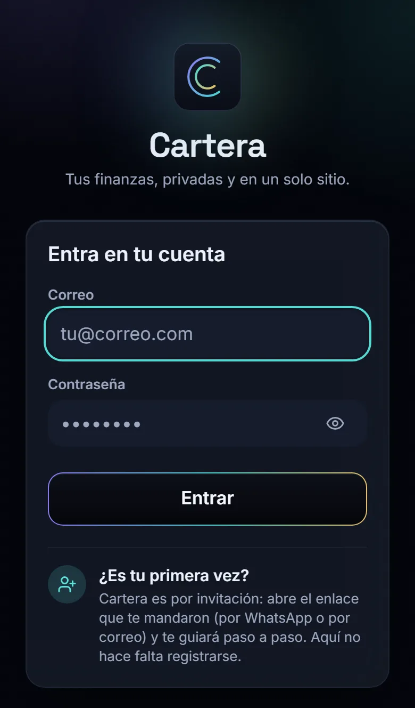
  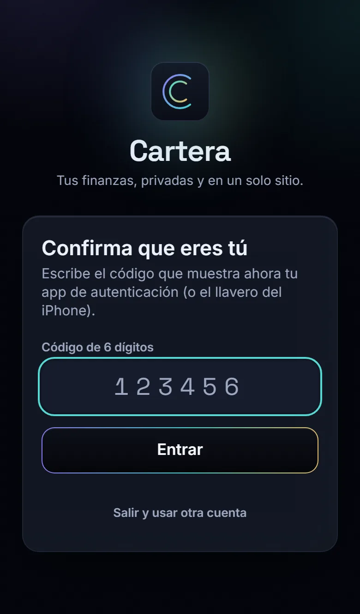

**Install it as an app.**
- **iPhone:** open it in **Safari** → *Share* → **Add to Home Screen**. It opens full screen with its own icon, and it is the only way to get notifications on iPhone.
- **Computer:** in Chrome or Edge, use the *Install* icon in the address bar. On Windows there is also a [desktop app](../../escritorio/README.md).

## 2. Getting around

| | Mobile | Desktop (from 1024 px) |
|---|---|---|
| Navigation | Bottom bar: Summary, Transactions, **+**, Accounts and Settings. The other screens hang off these. | Sidebar with every screen. |
| Add a transaction | The central **+** button. | **Add transaction** (*Añadir movimiento*), at the top of the sidebar. |
| Search | The magnifier in Transactions. | <kbd>Ctrl</kbd> + <kbd>K</kbd> from anywhere: searches your whole history. |
| Pending badge | Red counter on *Transactions*: Shortcut payments without a category. | Same, in the sidebar. |

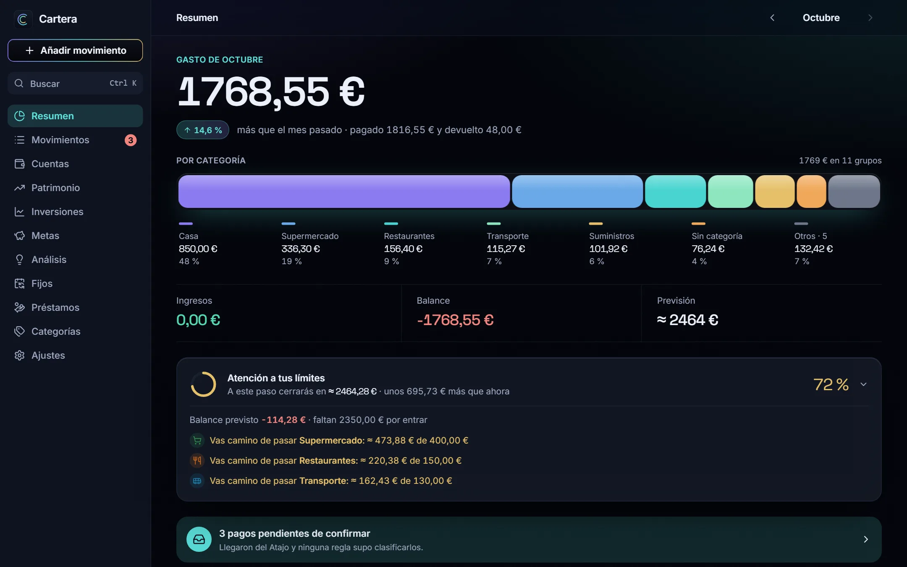

## 3. Summary

*Resumen*. The home screen: **the month at a glance**.

- **Month's spending**, compared with the previous month at the same point. Below it, what you paid and what you got back (refunds).
- **By category**: the *Aurora band*. Each colour is a category and its width is its share of the spending. Tap it to read each segment.
- **Watch your budgets** (*Atención a tus límites*): the month-end forecast and which budgets you are on track to exceed at this pace.
- **Payments pending confirmation**: what came in through the Shortcut that no rule could categorise. Tap to resolve it.
- **Month's pace** (*Ritmo del mes*): cumulative spending day by day against the same point last month (the dashed line).

The arrows at the top switch months.

  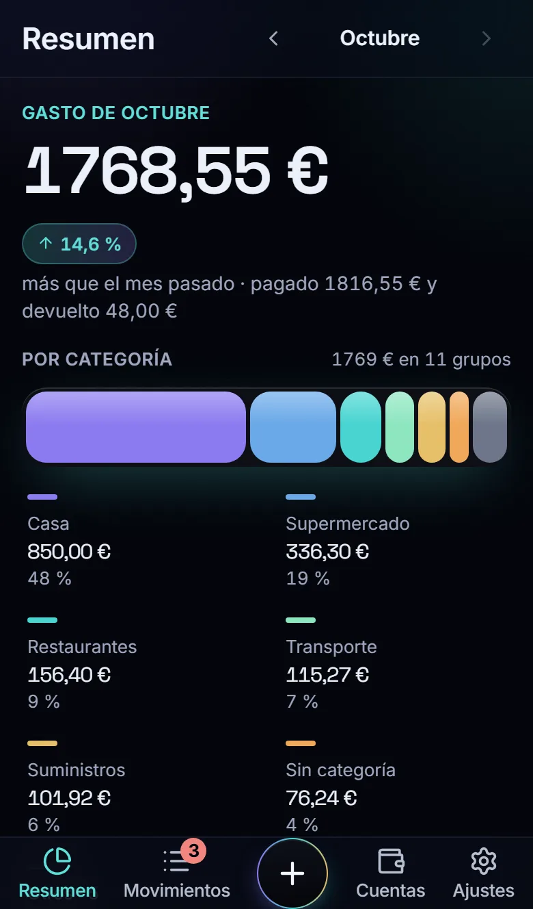
  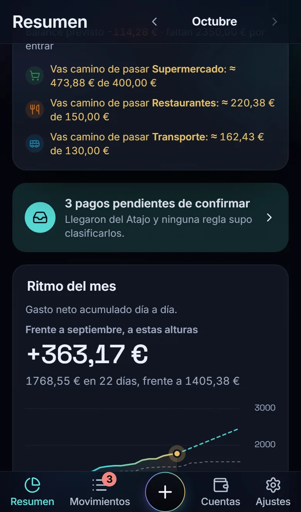

## 4. Transactions

*Movimientos*.

  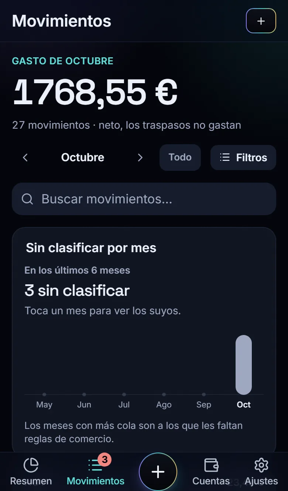
  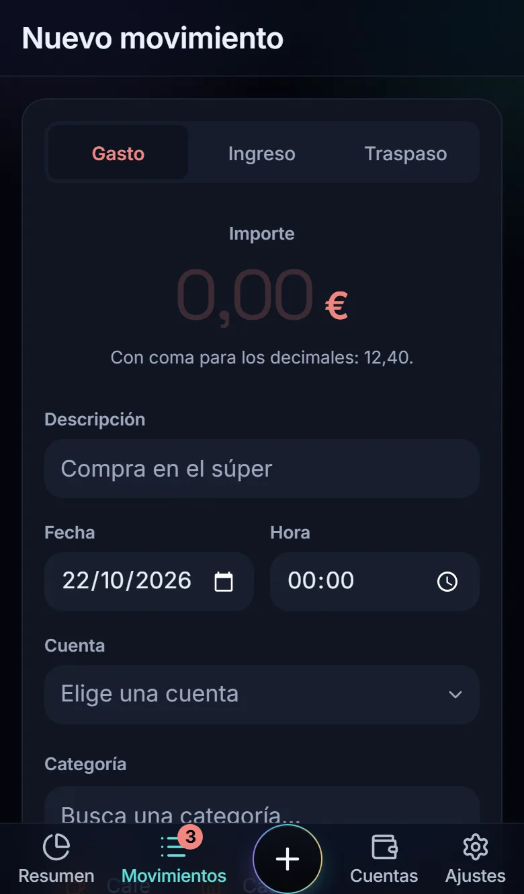
  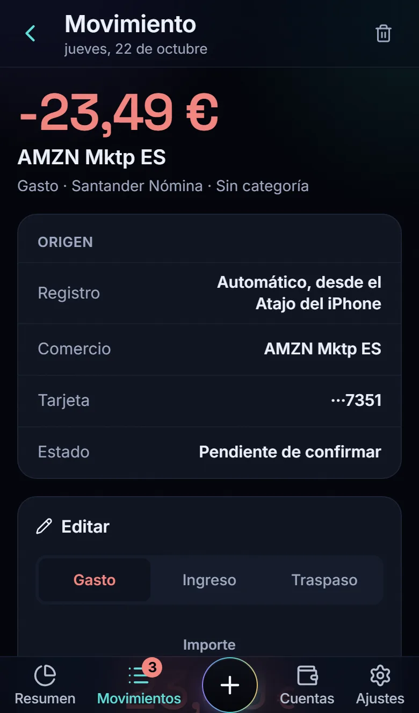
  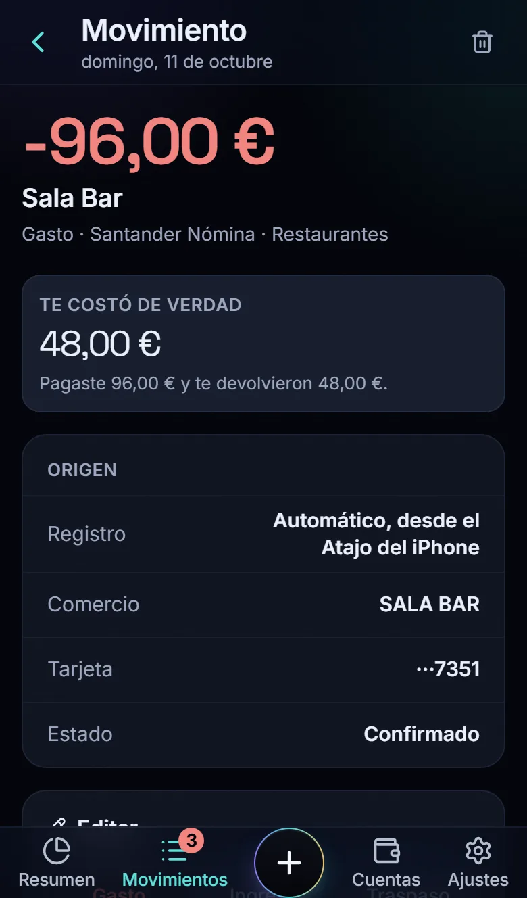

**The list.** Every transaction in the month, with search and filters by type, category, account, origin (*automatic only*) and status (*pending*). **Uncategorised by month** shows which months pile up payments without a category: those are the months missing rules.

**Adding.** There are three types:
- **Expense** and **Income** (*Gasto*, *Ingreso*): amount, description, date and time, account and category. Amounts use a decimal comma: `12,40`.
- **Transfer** (*Traspaso*): moves money between two of your accounts. It counts neither as spending nor as income, e.g. moving money into savings.
- **Save and add another** keeps the account selected, for entering several in a row.

**The detail view** (tap a transaction) shows where it came from (by hand, from the Shortcut with its merchant and card, from a recurring item or from an import) and lets you edit or delete it. A **pending** payment is resolved here by picking its category.

**Refunds.** If someone pays you back part of an expense (your share of a dinner, for instance), record it as income and **link it to the expense**. It does not count as income: it reduces that expense. The detail view puts it like this: *«Te costó de verdad 48,00 €»* — it really cost you €48: you paid €96 and got €48 back.

## 5. Accounts

*Cuentas*. Your accounts with their **current balance**: banks, cash, savings, investments and loan debt. The total at the top is what you have minus what you owe.

- Balances are **never typed in**: they are always computed from the opening balance and the transactions, so they cannot drift.
- Each account can have **several cards** (their last 4 digits), which is how the Shortcut knows which account a payment belongs to.
- An account you no longer use can be **archived**: it gets out of the way without losing its history. It can also be **deleted**; before that, Cartera shows what would go with it.

  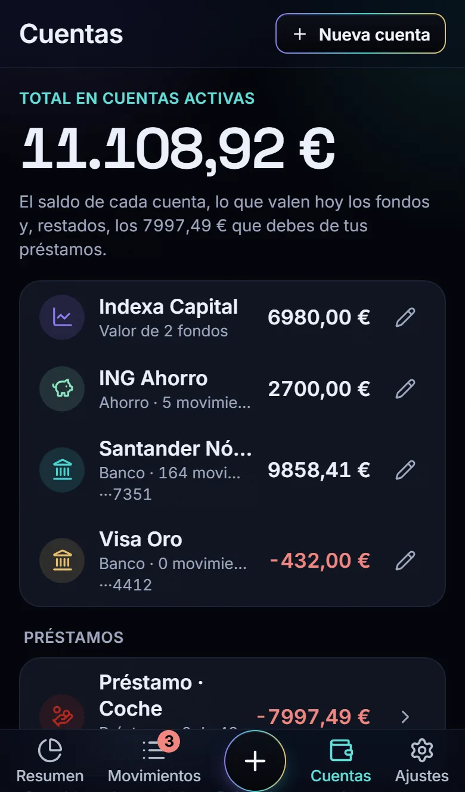

## 6. Net worth

*Patrimonio*. **Everything you have, together**: money in accounts, plus the value of your investments, minus what you owe.

- Daily **evolution**, with the period's high and low marked in gold. Ranges from one month to all-time.
- **Cash, invested and debt**: how much of your net worth is invested.
- **Savings month by month** and each year's close.

  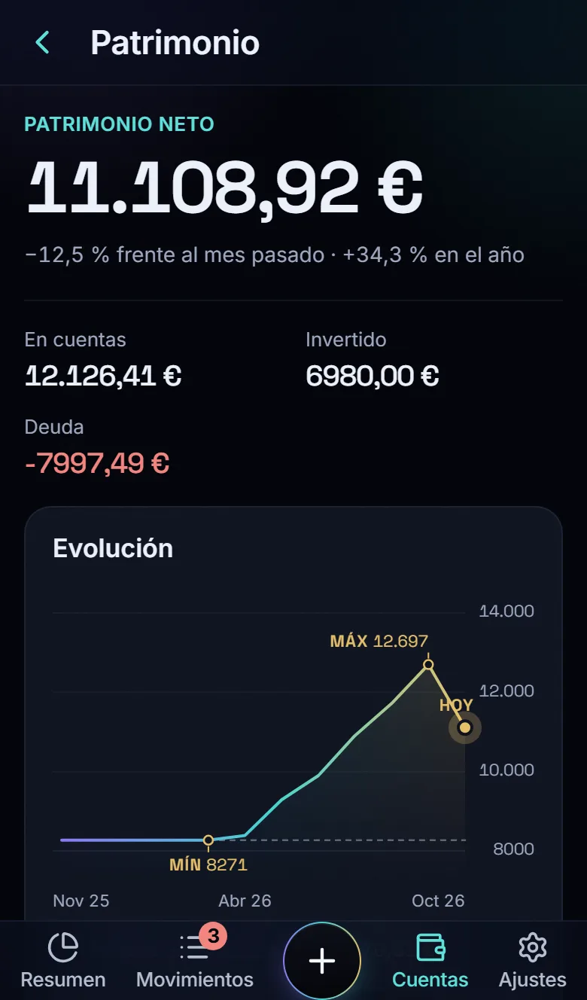

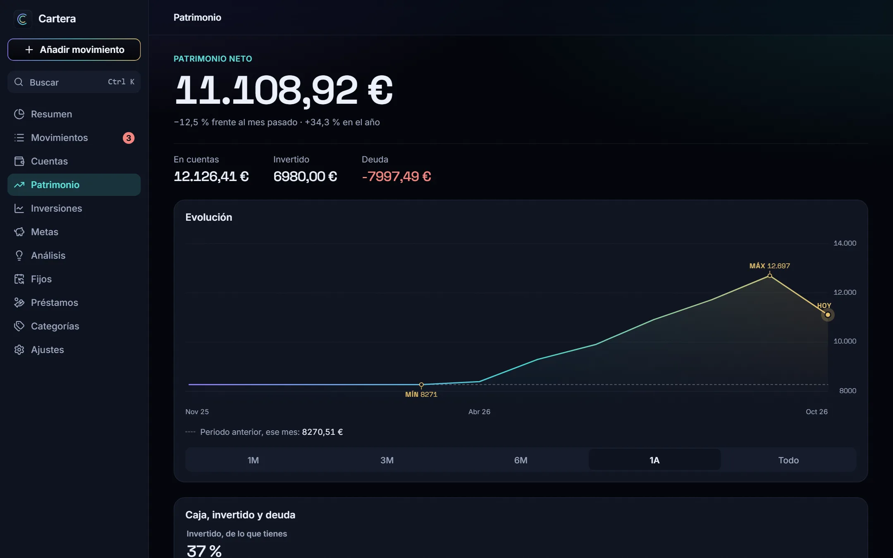

## 7. Analytics

*Análisis*. To understand **where the money goes**:

- **Forecast month-end close**, from your pace and what is still due (recurring items and loan instalments).
- **What's going on** (*Qué está pasando*): pending payments, uncategorised spending, exceeded budgets and saving streaks.
- **Year over year**: each month against the same month last year.
- **Calendar and heat map**: which days and hours you spend the most.
- The **merchants** you spend most at, per-category **trends**, and the month's **waterfall**.

Top right:
- **Report** (*Informe*): downloads the month's summary in Markdown, designed to be pasted into an assistant to ask what to adjust.
- **Month close** (*Cierre de mes*): a review of the finished month.

  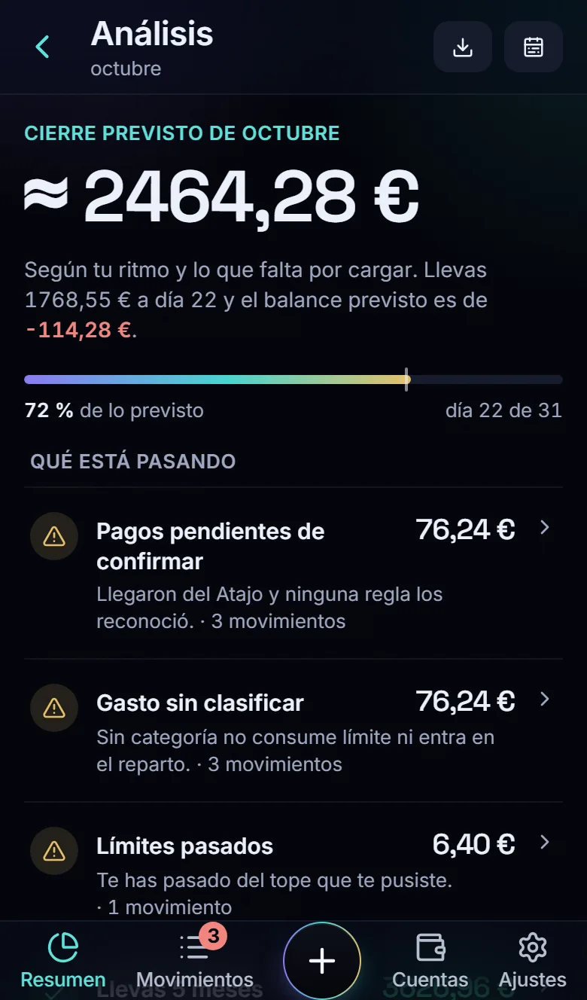
  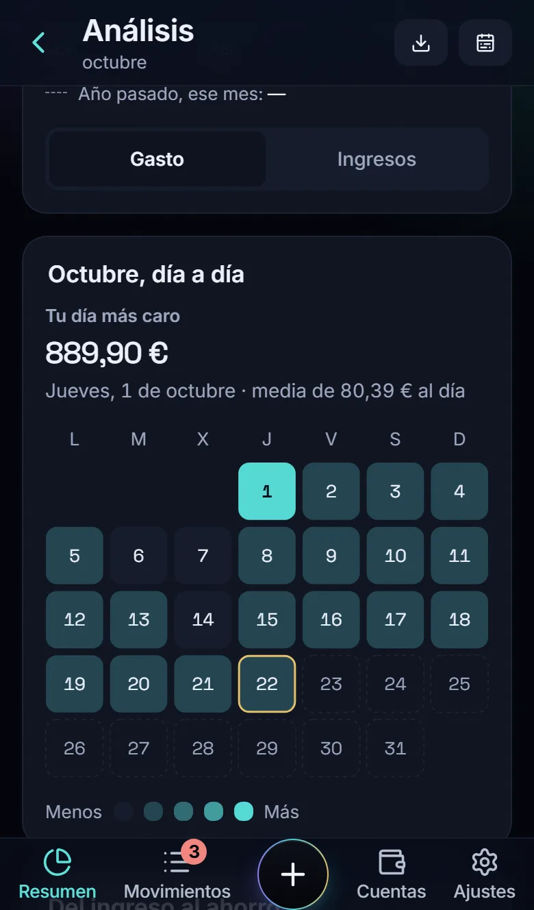

## 8. Recurring

*Fijos*. What **repeats**: subscriptions, bills and salary.

- **Net recurring per month**: what you start each month with. Recurring income minus recurring expenses, before day-to-day spending.
- **Recurring expenses** and **recurring income**, each with its frequency (weekly, monthly, quarterly or yearly) and next date.
- They are **recorded automatically** on their date: no need to enter them every month.

  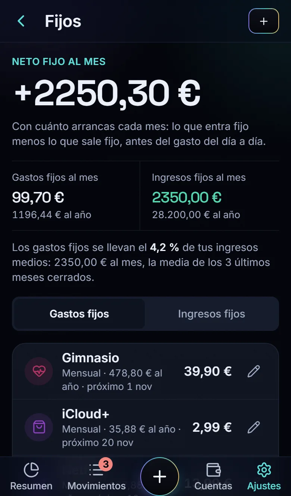

## 9. Goals

*Metas*. Savings targets, each tied to an account: *Trip to Japan: €4,500 in the savings account by June*.

- Progress, what is left and **how much to set aside each month** to make it.
- **Projection**: when you will get there at your current pace.

  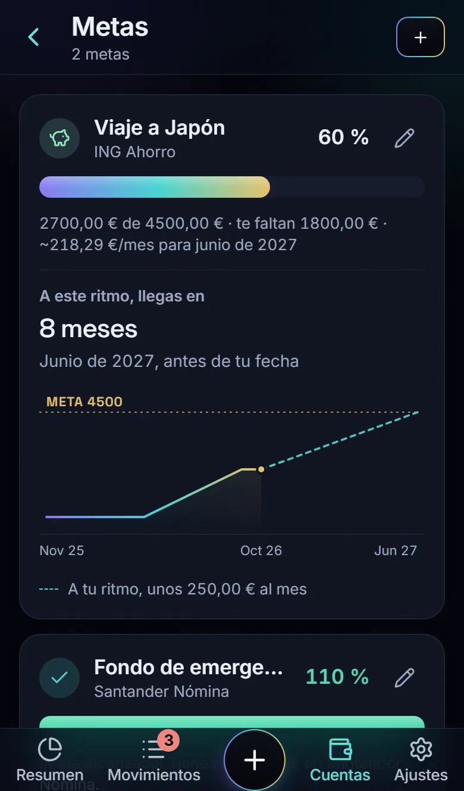

## 10. Investments

*Inversiones*. Funds, ETFs and stocks.

- **Follow an instrument** by searching its name, ISIN or ticker. Its price updates **automatically every day** (Yahoo Finance) and, if it trades in another currency, it is converted to euros with the ECB rate.
- For each position: **contributed, value, gain and return**. Return is measured on what you contributed: putting money in does not count as earning.
- It warns you when much of your money sits in a single position.
- Positions without a market price are valued by hand.

  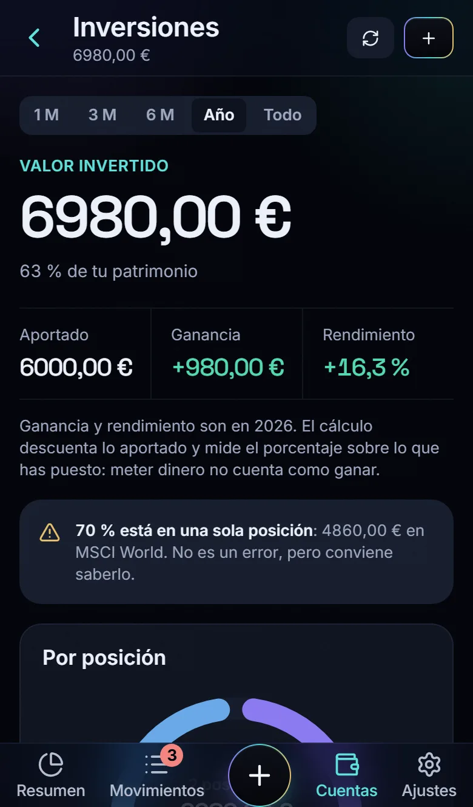

## 11. Loans

*Préstamos*. Mortgages, car loans or personal loans.

- You enter principal, term, nominal rate (and APR if you know it), payment day and start date. Cartera computes the **amortisation schedule** (French method).
- Every month the **instalment is recorded automatically**, split into interest (an expense) and principal (what reduces the debt).
- **Outstanding debt**, instalments paid, interest still to pay and end date. A loan can be **paid off** or cancelled.
- **Extra payment** (*Aportación extra*): you pay extra principal one month and choose **shorter term** (same instalment, you finish earlier: the biggest saving) or **lower instalment** (same end date, you pay less each month). Before saving, the preview shows when you finish, how many instalments are left and **how much interest you save**; the schedule is then recalculated. The last extra payment can be undone until another instalment is charged.
- **«I want to finish in N months» simulator**: how much extra to pay each month, or as a single payment today, and what you save. One tap fills in the payment.
- **Pay off the rest** (*Pagar todo lo que queda*) is one tap away on the loan card.

  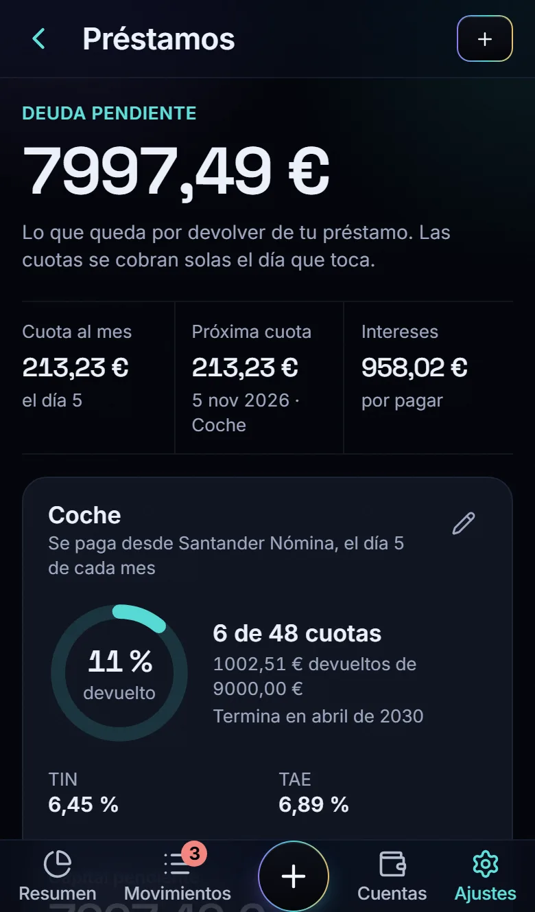

## 12. Categories and merchant rules

**Categories** (*Categorías*): expense, income and transfer categories, each with its colour and icon. Expense categories are what the Summary band splits.

**Merchant rules** (*Reglas de comercio*): when a Shortcut payment arrives, Cartera looks for a rule whose text appears in the merchant name (`MERCADONA` → *Groceries*).
- If one matches, the payment comes in **already categorised**.
- If there is no rule but you have **always** categorised that merchant the same way, it inherits that category.
- Otherwise it stays **pending**.

When you create a rule you can apply it to past payments in one go. Each rule counts how many times it has matched.

  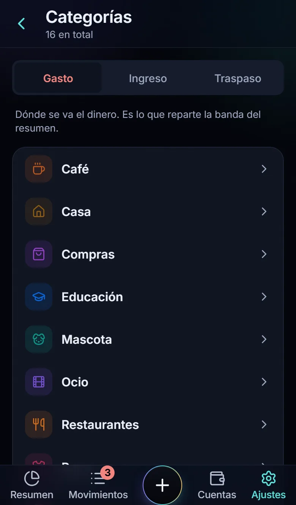
  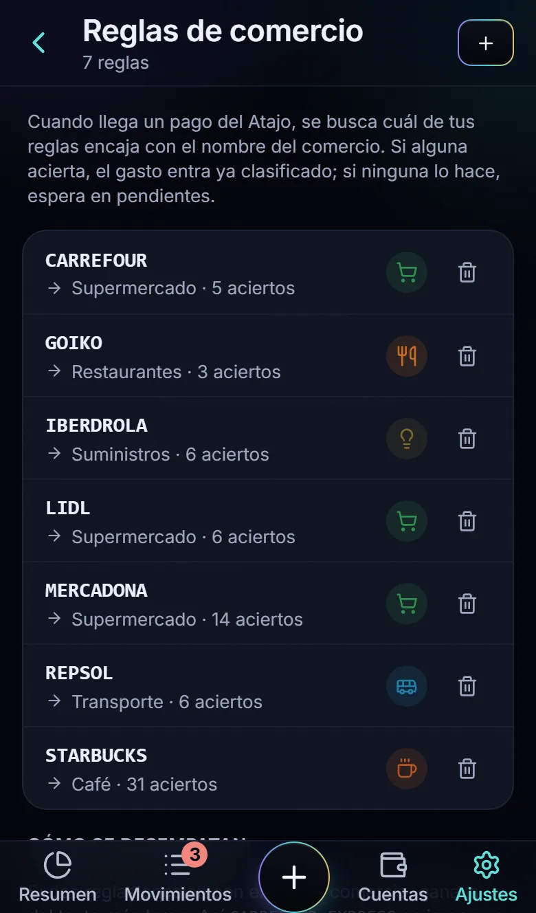

## 13. Bank import

*Importar*. To bring in at once what the Shortcut cannot capture (physical card payments, direct debits, online purchases):

1. Choose the **destination account** and upload the bank's **CSV**, or paste its contents.
2. Cartera detects the separator and suggests which column is the date, the description and the amount. You can correct it, and it **shows you what will be imported before writing anything**.
3. It flags transactions that **already exist**, so nothing is duplicated.

The file is not stored: only its rows are read.

  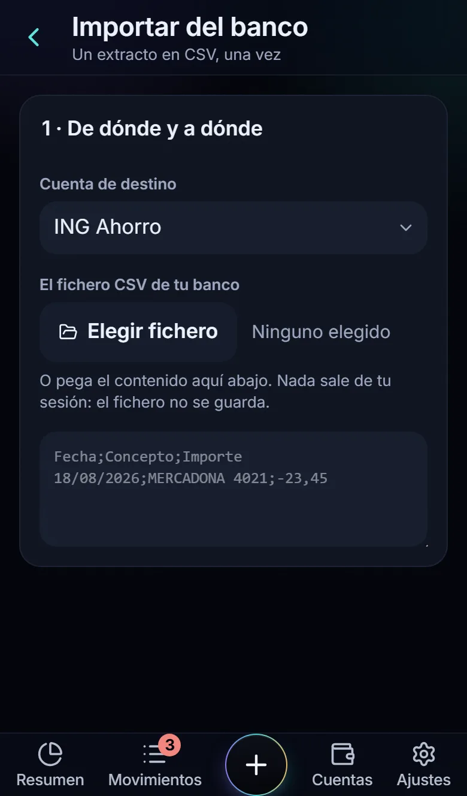

## 14. Settings

*Ajustes*.

- **Appearance**: light, dark or automatic.
- **The iPhone Shortcut** (*El Atajo del iPhone*): connect a device (this generates the *token*), see how many submissions it has made, revoke it, and choose the **default account** for payments made with a card Cartera does not recognise.
- **Phone notifications** (*Avisos en el móvil*): turn on notifications for this device.
- **Your data** (*Tus datos*): monthly report, export to CSV or full JSON, and import.
- **Security**: turn the second factor on or off.
- **Invite** (admins only): generates the link someone needs to join.

  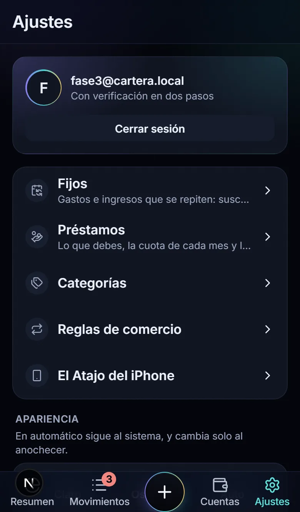
  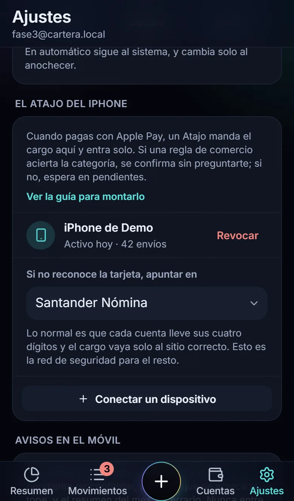
  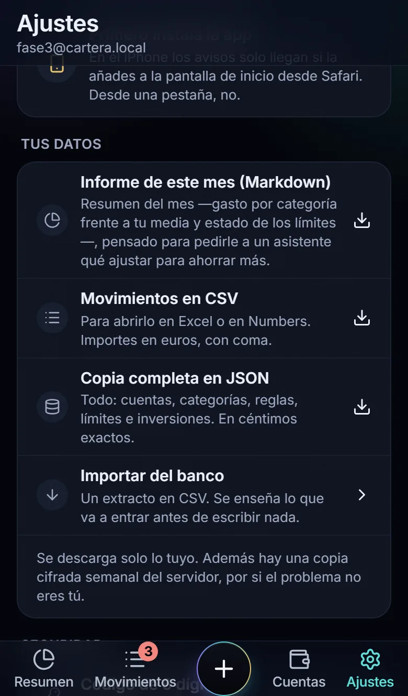

**Which notifications arrive.** On iPhone they only arrive with the app installed on the Home Screen. They are never sent between 23:00 and 08:00, except for a payment confirmation, which answers something you just did.

| When | Notification (as shown in the app) |
|---|---|
| You pay with Apple Pay and a rule categorises it | **Has pagado 4,20 € en Mercadona** · Asignado a Alimentación · Santander. — *You paid €4.20 at Mercadona · Filed under Groceries.* |
| …and your history categorises it | **Has pagado 3,50 € en Bar Pepe** · Asignado a Restaurantes, como otras veces. — *…as on previous occasions.* |
| …and nobody knows what it is | **Has pagado 15,99 € en Amazon** · Sin categoría todavía. Entra para asignarle una. — *No category yet. Open it to assign one.* |
| A budget reaches 80 % or 100 % | *You're at 80 % of Restaurants / You've gone over your Restaurants budget* |
| Pending items left unresolved | A reminder, once a day |

---

## 15. The iPhone Shortcut, step by step (iOS 27)

The Shortcut makes **your payments land in Cartera on their own**: you pay, and a few seconds later you get the notification with the amount and the category.

There are two ways to set it up:

- **Recommended: the Wallet notification.** Wallet (*Cartera*) notifies **every charge** on the cards you keep in it: Apple Pay, online, from another app or a top-up. A shortcut triggered by that notification captures them all. See [From the Wallet notification](#from-the-wallet-notification-recommended).
- **The Wallet automation** (steps 1 to 4). It only fires when you pay **by tapping the phone**: online purchases, payments from other apps or with the physical card do not trigger it. Those would be entered by hand or through [Bank import](#13-bank-import).

Both use the same token. If both are active, the same payment is not recorded twice: they are paired.

> [!NOTE]
> The iPhone screenshots below are in Spanish. iOS labels are given in English first, with the Spanish label in *italics*. They may differ slightly between iOS versions.

### Before you start: the token

1. In Cartera, go to **Settings → The iPhone Shortcut → Connect a device** (*Conectar un dispositivo*) and give it a name (*Pablo's iPhone*).
2. Copy the **token** that appears, which starts with `cart_`. **It is shown only once**: if you close it without copying, revoke that device and create another.
3. In **Accounts**, check that your card has its **last 4 digits** set, so the payment goes to the right account.

Inside the app, *See the setup guide* (*Ver la guía para montarlo*) also shows the exact server address and your cards' digits.

  
  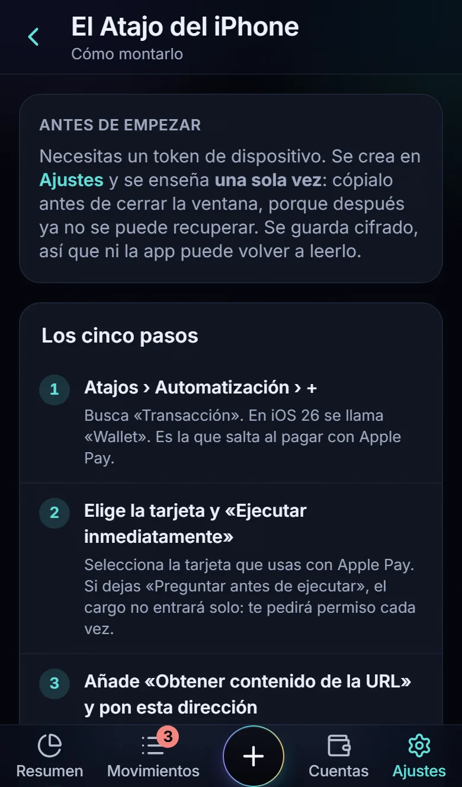

### From the Wallet notification (recommended)

1. In **Shortcuts**, create a new shortcut and add the trigger **«When I receive a notification from»** (*Al recibir una notificación de*) → pick **Wallet** (*Cartera*). Keep **Automation** on and **Notifications** off.
2. Add **Get Contents of URL** with the server address (`…/api/ingest`), method **POST** and the same `Authorization` header as in [Step 2](#step-2--the-request-to-cartera).
3. In **Request Body**, choose **JSON** with five **Text** fields. The last four are the **Shortcut Input** variable (*Entrada de atajo*): insert it, tap it and, under **Get**, pick the part of the notification:

| Key | Value | What it is |
|---|---|---|
| `source` | `cartera`, typed by hand | Tells the app this is a Wallet notification. |
| `tarjeta` | Shortcut Input → **Title** | The card: *Santander*, *Revolut*. Decides the account. |
| `comercio` | Shortcut Input → **Subtitle** | The merchant. The city it sometimes carries is removed. |
| `importe` | Shortcut Input → **Body** | The amount, *24,00 €*. |
| `fecha` | Shortcut Input → **Date** | When the notification arrived. Tells two identical charges apart. |

4. In Cartera, **Settings → The iPhone Shortcut → Wallet cards** (*Tarjetas de Cartera*): assign each card whose name **differs from its account** (the *Revolut* card to your Revolut account, if you named it differently). If the names match, it routes on its own.
5. If you had the Wallet automation, turn it off: this shortcut also captures Apple Pay payments.

Paying with one card **to another of your cards** (topping up Revolut with the Santander one) is recorded as a **transfer**, not as spending. Refunds and charges in other currencies are not recorded: they stay in the rejections list in Settings.

### Step 1 · Create the automation

1. Open **Shortcuts** → **Automation** tab → **+**.
2. iOS 27 opens **«Describe a shortcut»**. Don't use it: tap **Editor**, top right.
3. In the action list, open the **Automation** category and pick **Wallet**. The **«When I use …»** block (*Al usar …*) appears at the top.
4. Tap the card and pick yours, the one you use with Apple Pay. Leave **Categories** and **Merchants** on *Any category* and *Any merchant*.
5. Check the block's toggles:
   - **Automation** (*Automatización*): on.
   - **Confirm Before Running** (*Confirmar antes de ejecutar*): **off**. This is the important one: if it is on, every payment asks for permission and nothing comes in on its own.
   - **Notifications** (*Notificaciones*): up to you. It is iOS telling you the shortcut ran. Cartera's notification with the amount and category arrives either way.

  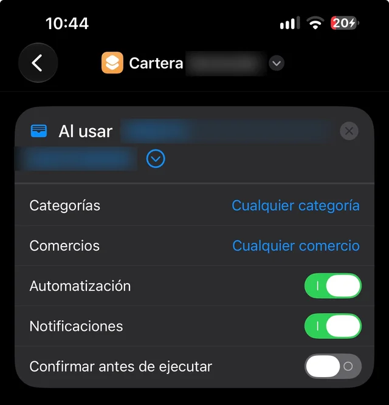

### Step 2 · The request to Cartera

1. Add the **Get Contents of URL** action (*Obtener contenido de la URL*) below the Wallet block.
2. Set the URL to `https://<your-domain>/api/ingest`, the address shown in the app's guide.
3. Expand the action with the arrow:
   - **Method:** `POST`.
   - **Headers → Add new header:** Key `Authorization`, Text `Bearer ` (with a space) followed by the token.
   - **Request Body:** `JSON`, then **Add new field → Text** three times.

### Step 3 · The three fields: this is where it usually goes wrong

| Key | Text | How to set it |
|---|---|---|
| `amount` | **Amount** (*Importe*) | Tap the field → **Select Variable** → tap **Transaction** (*Transacción*, below the Wallet block) → tap the bubble → **Amount**. |
| `merchant` | **Merchant** (*Comercio*) | Same: **Select Variable** → **Transaction** → bubble → **Merchant**. |
| `card` | `1234` | The card's 4 digits, **typed by hand**. |

In the screenshot, *Select Variable* shows two blue bubbles:
- **Transaction** (*Transacción*), right below *When I use…*: **this is the right one**, because it is the payment.
- **Shortcut Input** (*Entrada de atajo*), at the top: **not this one**. In iOS 27 it no longer carries the payment.

  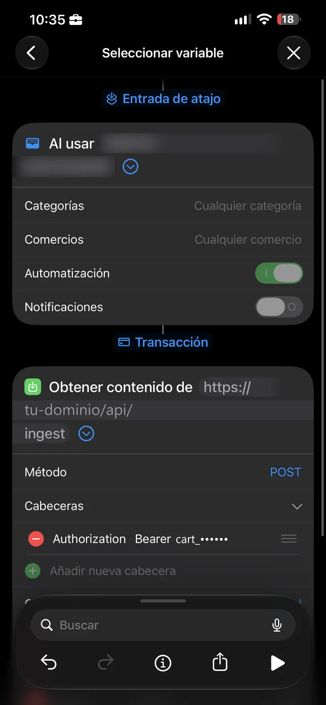

Tapping the **Transaction** bubble opens this menu. Under *Get* (*Obtener*), pick **Amount** for `amount` and **Merchant** for `merchant`:

  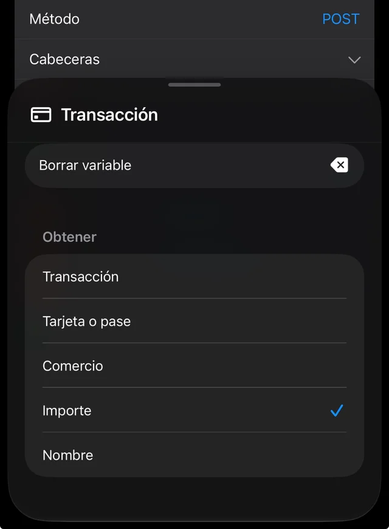

#### What it should look like

  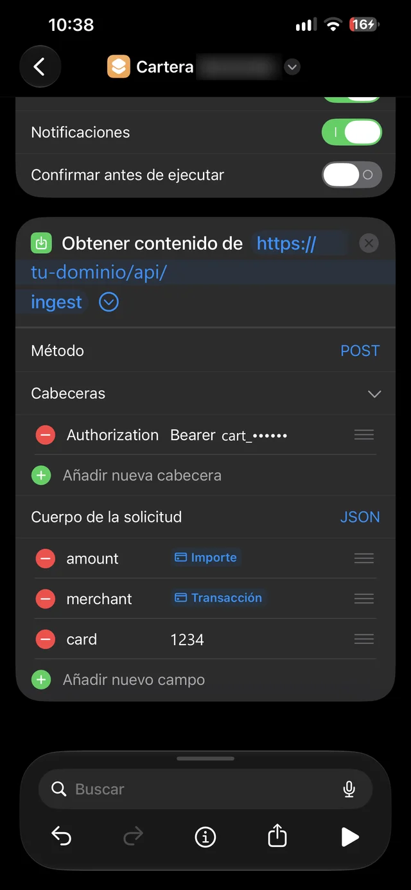

Check it top to bottom:

- **Confirm Before Running**: off.
- **URL**: `https://<your-domain>/api/ingest`. **Method**: `POST`.
- **Header**: `Authorization` → `Bearer cart_…`, with the full token.
- **Body**: `JSON` with three *Text* fields:
  - `amount` with the **Amount** bubble.
  - `merchant` with the payment bubble.
  - `card` with your 4 digits typed by hand.

> [!NOTE]
> In the screenshot, `merchant` holds the whole **Transaction** bubble, without picking a property. It works, because iOS turns the whole payment into the merchant name. Even so, it is clearer and more robust to tap the bubble and pick **Merchant**, just as **Amount** was picked for `amount`. For `amount`, picking **Amount** is **mandatory**: with the whole transaction the shop name would arrive instead, and Cartera would reject the payment as an *invalid amount*.

> [!WARNING]
> **If tapping the bubble only offers «Text», «File Size», «File Extension»…**, you inserted **Shortcut Input** instead of **Transaction**.
>
> To fix it:
> 1. Remove it with **Clear Variable** (*Borrar variable*) and insert **Transaction**.
> 2. If a **«Receive … from Nowhere»** block (*Recibir … de Ningún lado*) has appeared at the very top, delete it too: it is what turns the input into text.

  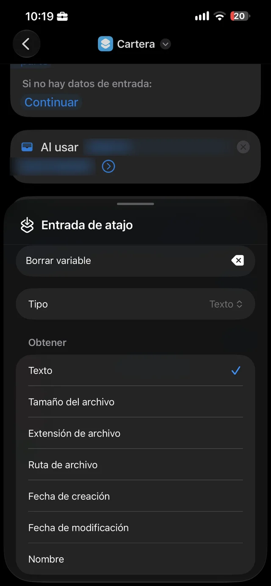

### Step 4 · Test it

- The editor's ▶ button **will always report an invalid amount**: without a real payment, the trigger has no amount. That is not a bug.
- **Pay for something small with Apple Pay.** Within seconds you should get *«Has pagado … en …»* (*You paid … at …*) and the transaction appears in Cartera.
- If you pay with **several cards**, create **one automation per card**, identical except for the `card` field. The same token works for all of them.

---

## 16. Troubleshooting

<b>The payment doesn't come in</b>

Check the submission counter in **Settings → The iPhone Shortcut**:

- **It doesn't go up.** The Shortcut isn't reaching Cartera. Check that the automation is enabled and set to run on its own, and that the URL is exact.
- **It goes up, but there are rejections.** Cartera stores every rejected attempt with what it received and why:
  - *Invalid amount* with the shop name as the amount → in `amount`, **Amount** wasn't picked inside the bubble.
  - *unauthorized* → the token is incomplete or `Bearer ` is missing. Create a new one and copy it in full.
  - *Text without numbers* → the field contains the variable's name typed out instead of the variable itself.

<b>The payment comes in, but without a category</b>

That is expected the first time at a new merchant: it stays **pending**. Assign a category from the notification or from Transactions and, if it will repeat, create a **merchant rule**. From the second payment on, it comes in categorised.

<b>Notifications don't arrive</b>

1. Open Cartera **from its Home Screen icon**, not from Safari.
2. *iPhone Settings → Notifications → Cartera*: allowed, and no Focus mode silencing them.
3. In **Cartera → Settings → Notifications**, turn them off and on again. If you removed and re-added the app to the Home Screen, the old subscription no longer works and a new one is needed.

<b>I lost the token</b>

It cannot be recovered: it is stored hashed and not even the app can read it. Revoke that device and connect a new one.

---

To regenerate the screenshots: `scripts/seed-demo.mjs` and `scripts/seed-guia.mjs` on a `@cartera.local` user, a running production build (`npm run build && npm run start`) and [`scripts/capturas-guia.mjs`](../../scripts/capturas-guia.mjs).
